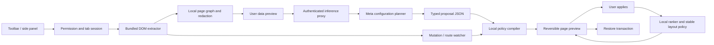

# Smart Web: end-to-end system plan

Status: proposed architecture, 27 October 2026. This document specifies future work; the existing repository is an adaptive app prototype, not a shipping browser extension. Read [research and scoring](research-and-scoring.md) for sources and evidence boundaries.

## Product thesis and scope

Let people make an unfamiliar webpage fit the task they are doing: the extension understands its layout, proposes a usable configuration, previews the change, and learns which approved elements matter over time. The user should never need to write selectors, prompts, or model parameters to get started.

Initial audience hypothesis: people who repeatedly navigate dense work websites—documentation, issue trackers, knowledge catalogs, and dashboards. Primary job: find the next relevant destination or control quickly without losing the page's meaning or familiar position. Validate this with actual users; the existing synthetic sessions do not establish market demand or accessibility outcomes.

Full vision is cross-site smart layout, not just a side-panel shortcut list. The hackathon must demonstrate actual in-page presentation changes on multiple previously uninstrumented layouts, plus generated local ranking configuration. Where reflow is unsafe, show a clearly labeled limited mode. Never count limited mode as successful arbitrary-page reflow.

**Required end-to-end learning proof:** a Meta-generated catalog grounded to actual page nodes receives deliberate local activation/pin feedback, produces a queued preference-driven proposal, and after user acceptance changes an approved **in-page** property such as emphasis of the preferred card. Static page reflow plus an unrelated learned shortcut list does not satisfy this gate. Record the chain from node IDs through catalog, observations, ranking delta and accepted transaction. Distinguish initial model-proposed layout from later locally learned changes.

Provisional product name: Smart Web. Core promise: **Your page, arranged for your task.** Recommend Build for Your World; choose Indie only if the actual team fits it. The goal is a compelling new extension contribution with useful evidence, not maximum feature count.

### Delivery tiers

| Tier | Required behavior |
|---|---|
| Hackathon vertical slice | Chrome MV3; toolbar activation; semantic page scan; Meta configuration proposal; region correction; constrained preview; meaningful page layout/spacing/emphasis changes; apply/restore; per-origin local learning; pin/pause/reset; dynamic-page invalidation; honest unsupported states |
| Following iteration | More transformation families, tested adapters for virtualized/framework-owned regions, optional persistent per-site permission, schema migrations, export/import and cross-device preferences with explicit consent |
| Full product | Browser portability, multilingual/RTL coverage, more complex applications, wider accessibility testing, shareable reviewed recipes, automatic repair with confidence and user control |

Calendar tiers do not remove the long-term requirements. “Any webpage” means attempt discovery and report supported capability per region; browser-protected pages, unpermitted frames, canvas-only interfaces and unsafe structures cannot honestly receive a universal guarantee. Closed-shadow traversal is a deliberate initial exclusion, not an inherent Chrome-extension access prohibition.

## Architecture



The cloud configures; the browser owns execution. A Meta model proposes page semantics and bounded parameters. It never supplies arbitrary executable code, receives credentials, or gets an action tool that purchases, submits, deletes, or sends. The runtime cannot expand its own allowed operations from model output.

Initial manifest permissions: `activeTab`, `scripting`, `sidePanel`, `storage`; host permission is limited to the chosen backend origin. No blanket website host access is required for the toolbar-triggered baseline. Set and test Chrome 116+ as the minimum for programmatic side-panel opening. Inject packaged `content.js` into main frame 0 in `ISOLATED` world. Same-origin permission survival does not preserve content-script instances across document navigation: always reattach and regenerate identities. See the [technical review](technical-validation.md), TV-07, for primary documentation.

### Components and ownership

| Proposed path | Responsibility | Reuse / change |
|---|---|---|
| `extension/manifest.json` | MV3 permissions, worker, panel, packaged assets | New |
| `extension/background/` | Toolbar activation, tab/document routing, auth, proxy requests, request deduplication | New; no dependence on worker RAM surviving suspension |
| `extension/content/extract.ts` | Accessible DOM cues, grouping, geometry, opaque node registry | New; no hardcoded site IDs |
| `extension/content/observe.ts` | Mutation batching, route identity, resize invalidation, cleanup | New |
| `extension/content/transactions.ts` | Apply bounded changes, record inverse operations, restore | New |
| `extension/panel/` | Consent, proposal review, preview controls, learning and recovery | New React UI; existing components may inform styling |
| `packages/layout-contract/` | JSON schema, operation definitions, validator and compiler | New shared module |
| `server/` | Provider adapter, auth, rate/cost caps, schema validation, minimal logs | New; provider key server-side |
| `src/model/ranker.ts` | Generic catalog ranking | Reuse after explicit catalog persistence/migration work |
| `src/cssnet/` | Local CSS inference and JS reference | Existing foundation; extension-context validation needed |
| `src/signals/` | Local interaction features | Adapt; current extractor identifies app-specific `data-testid` targets |
| `tests/extension/`, `eval/layout/` | Fixtures, fault tests, held-out pages, user-study records | New |

Do not refactor the whole app before the first extension slice. Use a separate extension build entry while retaining the current demos as clearly labeled inherited reference fixtures. Reuse React/TypeScript/Vite already present; start with native browser APIs and a small server rather than adding an agent framework. A compiler with a finite operation set is easier to evaluate than unrestricted browser control.

## Discovery and the page graph

1. A toolbar click establishes the tab session. Open the panel from that gesture. Validate HTTP(S) and injection permission; reject browser settings, store pages and other blocked contexts gracefully.
2. Traverse the DOM in bounded chunks. Use semantic elements, roles, ARIA labels, visible text snippets, rectangles, link/button relationships, repeated sibling structure, computed display/layout cues, and open shadow roots where accessible. This is a DOM-derived semantic map, **not** access to the browser's internal accessibility tree.
3. Assign random/session-scoped opaque IDs, retaining actual DOM references in a local registry. Keep fallback fingerprints local: role, sanitized name, stable attributes, ancestor structure and sibling context. Avoid absolute XPath as the only identity. Duplicate or weak matches must abstain rather than guess.
4. Classify regions into independent content grids, navigation, article sequence, forms, ordered tables, live/virtualized lists, overlays, and unknown. Protect forms, active editing, dialogs, authentication, money transfers and destructive actions by default. Exclude scripts, hidden content, form values and contenteditable text from upload. Treat visible text as potentially sensitive too.
5. Initial scan budgets: 5,000 traversed elements, 200 summarized candidates, 6 learnable groups and 40 learnable items total. These are proposed limits to profile, not browser limits. If truncated, say which areas were not scanned; allow user-selected rescan of a region.
6. Send only user-reviewed structural data and short sanitized labels. Strip query strings and fragments; retain origin locally and send a coarse page type where possible. Screenshot mode is optional and off by default. Show the exact cropped/redacted image before upload, omit sensitive regions entirely, and warn that visible pixels can contain personal information. No claim that redaction is perfect.

Page identity is `{tabId, frameId, documentId/sessionNonce, routeKey, graphVersion}`. UI proposals also carry `requestId` and `proposalId`. A response for another tab, older route, stale graph or canceled request must never be applied. Recheck immediately before every preview and apply.

## Configuration and execution contract

The following is an illustrative contract instance, not a provider-tested schema. Build the strict JSON schema as a first implementation artifact. Provider-generated IDs must reference the candidate IDs in the request; never interpret them as selectors or URLs.

```json
{
  "schemaVersion": 1,
  "graphVersion": "g17",
  "goal": "Find reference sections quickly",
  "groups": [
    {
      "id": "grp1",
      "regionId": "node7",
      "itemIds": ["node8", "node9", "node10"],
      "mode": "independent-cards",
      "reason": "Separate reference destinations with repeated structure"
    }
  ],
  "operations": [
    {"kind": "setDensity", "targetId": "node7", "value": "comfortable"},
    {"kind": "emphasize", "targetId": "node9", "value": "outline"}
  ],
  "learning": {
    "enabledByDefault": false,
    "profile": "stable",
    "signalTypes": ["activate", "pin", "unpin"],
    "minEvidence": 5,
    "maxMovesPerBoundary": 1
  },
  "limitations": ["Article paragraphs preserve their original sequence"]
}
```

The server adds trusted provider metadata; the extension binds proposal identity locally. A model's claimed confidence is explanatory only, never a permission or safety threshold. The local compiler intersects proposed groups and operations with structural eligibility and user selections.

| Operation family | Permitted execution | Reject / downgrade when |
|---|---|---|
| Density and typography | Bounded gap, line-height, width and font-size tokens on approved regions | Clipping, overlap, inaccessible controls, unexpected responsive breakpoints |
| Emphasis / focus | Local outline/background tokens; optional reversible dimming of user-selected ancillary content | Hides warnings, labels, focused controls, or meaningful relationships |
| Independent card reflow | Change grid columns/gaps while preserving meaningful content order | Reading/interaction sequence would change or target is virtualized |
| Ranking in extension-owned destination list | Reorder native safe destination links with coherent DOM/focus order | URL is executable, unsafe, or not part of source allowlist |
| In-page sibling reorder | Later/conditional: only a validated adapter with semantic, framework, focus and restore tests | Generic framework subtree, ordered narrative, table, form, menu or uncertain semantics |

At least density/reflow/emphasis on actual page regions must work for the hackathon. A destination list alone fails the central in-page layout objective. Conversely, visual CSS `order` is not sufficient proof of correct keyboard/reading order. Do not reparent arbitrary React/Vue nodes or clone live buttons and assume their behavior survives.

Generic operations explicitly prohibit node reparenting/`appendChild` ranking, cloning live controls, positive-tabindex repair, CSS `order`, and dense grid placement that changes sequence. Eligibility is operation-specific and checks descendant controls, overflow, sticky positioning and responsive behavior. A model's “independent cards” label cannot certify eligibility. Source-order preservation is our conservative product policy; WCAG permits multiple logical orders where meaning and operation are preserved. Test semantics manually as well as checking geometry.

Validation pipeline: parse and size-check → strict schema → version/identity check → ID existence and uniqueness → group bounds → operation/value allowlist → protected-region checks → viewport/sequence/interaction checks → normalized transaction. Reject unknown fields, non-finite numbers, oversized lists, URL-bearing style values, unrecognized verbs and unsafe targets. If invalid, one Meta repair call can receive only validation errors and the same bounded candidate map. A second failure produces no applied changes and offers manual region selection.

Preview uses the same transaction engine as Apply, tagged provisional; Cancel requests guarded restoration and reports pending or partial recovery. It is a real temporary change, not an exact simulation of an arbitrary website. Display “Preview on — changes are temporary.” Snapshot touched inline properties/attributes and exact injected stylesheet IDs, plus relevant focus and scroll anchor. Restoration removes only extension-owned state and reverses only values still owned by that transaction, preserving intervening host edits. If a node is removed, skip it; never resurrect a stale subtree. Any partial rollback must be reported, with reload available as a user-controlled last resort because reload can lose unsaved edits.

The [selected UX specification](ux-spec.md) governs interaction defaults. First show non-mutating outlines; live Preview is a separate deliberate action. Learning stays frozen in preview. Proposed cleanup lease: renew from a visible, connected panel every 5 seconds; after 30 seconds without renewal, transition to `expired-pending-restore`, immediately disable Apply/learning, then restore geometry at a safe interaction boundary. Do not move a pointer-down target, active selection or focused region solely because a timer expired. Timer throttling means this is not a hard real-time guarantee; recheck on visibility/focus/resume and reattach. Explicit Cancel requests restoration, suppresses new work and waits out an active pointer gesture; preserve current reachable focus rather than stealing focus back after deliberate navigation. Scope Escape to extension selection/preview controls so website menu dismissal does not also cancel preview. Apply removes the provisional lease and makes the transaction visit-scoped; panel closure or a crash never approves changes. Document invalidation removes stale bindings and safely owned state; removed nodes need no resurrection. Test suspension, pointer-down expiry, selection, focus, menu Escape and browser restoration. Layout undo cannot undo website actions taken during preview.

For reversible CSS-only changes, service-worker termination must not strand the user: the content script owns the rollback handle, and the panel can reconnect. Fresh documents cannot inherit old DOM handles. On extension startup, reconstruct approved configuration from extension storage and rescan; never deserialize live transactions blindly. Observer detects major route/layout changes, stops adaptation and requests renewed review. Ignore known self-writes to avoid mutation loops; use batched reads then writes, not interleaved layout thrashing.

## Local learning and model setup

Translate validated groups into `Catalog` for the existing generic ranker. Its shape depends on group/item counts; the current hidden-layer default is 16. The compiler, not the LLM, chooses allowable dimensions and hyperparameters. Initially expose user concepts—Stable, Comfortable, Compact—not learning rate, layer widths, selectors or reward weights. Advanced read-only configuration inspector makes the Meta contribution auditable.

Initialize uniform item priors; pinning is an explicit hard constraint. Learn activation counts and deliberate feedback; avoid interpreting dwell, cursor tremor, rapid clicking or backspaces as mental state, disability or intent. Pointer intensity can be an opt-in research feature later; it is not required for the first useful model. Keyboard activations receive equal support. Do not capture typed characters or form contents.

Start with explicit Apply, then ask whether to enable local learning for this site. **The MVP queues all learned changes for explicit review.** Automatic changes are later experimental policy, only inside the approved operation family and after separate opt-in. Freeze geometry changes while a region has focus, pointer presence, pressed pointer, active selection, scrolling, editing or an open menu. Apply this guard to preview toggles, initial Apply and rollback as well as automatic updates. Proposed later stability policy: at least five deliberate observations, at most one item move per boundary, 0.15 normalized score margin, and 30 seconds between automatic updates. These values require tuning against task accuracy and annoyance; ranking moves are confined to extension-owned lists or separately validated adapters.

Pin beats learned ranking; Pause freezes output and collection; Undo layout does not erase learned data and suppresses the rejected suggestion for the visit; Reset learning erases the site's model and history. Keep these separate and explain the difference. Do not train on programmatic clicks or synthetic replay as though they were the user's behavior.

Store per-origin + route-family + catalog fingerprint + schema version in extension-owned storage, not the website's IndexedDB. Persist ordered group IDs, ordered stable semantic item IDs and membership, feature schema and model schema; separate these from transient DOM node IDs. Existing shape checks and optional sorted-set comparisons do not protect against item/group permutations. MVP resets on any nonidentical ordered mapping, including permutations, rather than partially migrating neural state. Future migration must remap output rows/biases, affinity, group-context input columns, group counts and saved order together. Reject duplicate/empty groups, invalid item/group pairs, malformed normalization arrays and out-of-bounds dimensions before training or load. Default retention proposal: 30 days since last use; reset/delete and denylist controls always available. Incognito has no persistence by default. No cross-origin behavioral pooling.

**Inference decision after technical review:** begin with bundled JS inference. The existing CSS implementation appends styles to the host document head and shares property names; wrapping its nodes in a shadow root does not isolate it. If retained for demonstration, compute CSS in the extension's side-panel document, with JS maintaining functionality after the panel closes. A future content-side CSS path needs explicit stylesheet/property scoping work. Separately test content-script CSP, extension-document CSP and stylesheet insertion; do not assume all are identical. Run nonzero randomized parity checks under restrictive style policies, hostile resets, multiple instances and panel closure. Disable CSS on mismatch and expose the selected engine truthfully. Never market this as the Meta model running in CSS: Meta creates configuration; the tiny local model performs adaptation.

The content script owns the live per-document ranker, sequenced native activation adapter, DOM registry and rollback handle. The background worker mediates acknowledged storage revisions and provider dispatch; the panel displays state and user decisions. Keep state visit-scoped until Remember on this device is explicitly chosen. Only then persist at bounded event checkpoints; report unsaved status until acknowledgment. After restart, load only a matching acknowledged revision, and identify any lost unacknowledged events as a limitation. Simultaneous tabs use independent session deltas and serialized per-origin revision updates; on a conflict, keep the current tab's changes visit-local and ask for review rather than silently overwriting a model. The existing dedicated Web Worker client/protocol has fixed app types and pending promises; do not reuse it as an MV3 service-worker protocol.

Build a fresh activation-only adapter instead of attaching the inherited global pointer/keyboard collector. Resolve only current permitted registry targets, count native keyboard/pointer activation once, reject synthetic clicks as learning evidence, and stop collection in preview/Pause. `isTrusted` is one filter, not proof of intent. For the initial blend, use documented neutral pointer inputs and a versioned feature policy; compare against affinity-only ranking. No raw key values or pointer trajectories are needed for this slice.

## Backend, privacy and operations

Proposed endpoints: `POST /v1/layout-proposals` (bounded graph and user goal), `POST /v1/layout-proposals/:id/repair` (one allowed repair), and `DELETE /v1/sessions/:id` (ephemeral request state). Session authentication must use an expiring token issued after actual login/access authorization; a public token embedded in the extension is not authentication. Restrict provider model IDs, schemas, token limits and tools server-side. A tightly rate-limited demo account may be used with documented expiry.

Initial caps: 256 KB sanitized JSON input, 200 candidate nodes, 4,000 output tokens, 20-second synchronous request deadline, one repair, bounded transport retry for 429/temporary errors honoring Retry-After. This leaves margin against Chrome's documented 30-second fetch-response service-worker termination boundary. Longer inference requires a promptly acknowledged authenticated server job/status protocol, not an indefinitely pending worker fetch. Charge retries against the same reserved budget. Cancellation must prevent subsequent apply even if upstream inference cannot be canceled. Return stable errors: access denied, unsupported page, stale page, provider unavailable, invalid plan, budget exhausted, timeout. Check provider truncation/completion status before parsing; compile operation unions into the provider's supported strict schema subset and smoke-test acceptance.

Cloud logs retain request ID, model/version, token usage, timing, error class and validator counts; no raw DOM, labels, screenshot or full URL by default. Keep sensitive request buffers ephemeral. Operational deletion cannot promise erasing provider logs; document provider terms before release. The backend receives untrusted data, cannot fetch arbitrary user-supplied URLs, and cannot execute generated code. Render all model explanations as text.

Persist background state at request boundaries. Server-side deduplication binds authenticated user + request ID + payload hash to one job/charge; an idempotency header alone is insufficient. Trusted extension UI approves an immutable payload hash and tab/document identity; any changed labels, goal or screenshot require renewed review. Derive sender identity from browser-supplied message context, never a claimed tab ID in message data. Reject stale/replayed consent. Restrict session/auth storage to trusted contexts with `chrome.storage.local.setAccessLevel({accessLevel: 'TRUSTED_CONTEXTS'})`; content scripts receive only scoped model/configuration state through validated messages. Fixed backend endpoints, message size/rate caps and no privileged general fetch relay are required. Reconnect panel by tab/document session. No cross-tab apply. One active transaction per document, serial revisions, and revision comparison before writes. Offline: valid saved configuration can be reviewed locally; new Meta configuration is unavailable and never falsely marked freshly analyzed.

## Compatibility contract

| Page / situation | Expected capability |
|---|---|
| Semantic public documentation or content grid | Scan, configure, preview bounded in-page reflow, local destination ranking |
| SPA rerender / route change | Detect version change, pause, rescan; keep original usable |
| Framework-owned interactive list | No generic structural reorder; eligible style adjustments or limited focus/jump mode |
| Cross-origin iframe | Treat as opaque in baseline; explicit frame permissions and separate adapter work needed |
| Open shadow root | Best-effort discovery; separate style scope and tests |
| Closed shadow root | Excluded from MVP traversal/mutation by choice; Chrome exposes `chrome.dom.openOrClosedShadowRoot(element)` for possible later inspection, still requiring behavior/style tests |
| Canvas-only UI | No internal DOM semantics to extract; image understanding alone cannot supply safe native interaction semantics |
| Forms, editor, checkout, account/security surface | Exclude sensitive regions; no automatic task execution or layout rearrangement there |
| Browser-internal/restricted page, PDF viewer | Unsupported baseline with explanation and another-page action |
| Huge / infinite page | Bounded scan, visible partial-coverage label, manual region selection |
| Screen reader / keyboard / zoom | Stable mode, coherent focus, no automatic focus movement, review before changing sequence |

## Implementation schedule and gates

Dates assume one builder, with tasks that can be split across up to four accepted teammates. Roles are work areas, not a claim that four people are available. Critical path is permission → discovery → contract → real Meta proposal → reversible in-page change → evaluation → demo.

| Date | Work and owner role | Exit evidence |
|---|---|---|
| Oct 27 | Lead: baseline/new-work boundary, model access spike, extension packaging and permission lifecycle | Install unpacked extension; toolbar opens panel and scans one owned fixture; provider returns one valid strict-schema response |
| Oct 28 | Extraction role: DOM map, region identity, sensitive exclusion, mutation tracking | Three distinct fixtures discovered without app-specific target IDs; stale IDs and protected regions rejected |
| Oct 29 | Model/contract role: Meta proposal, semantic validator, data preview, one repair | First real scan → proposal → preview → restore on uninstrumented page; no raw generated code execution |
| Oct 30 | Runtime role: density/reflow/emphasis, rollback, keyboard/focus guards | Two page families retain functionality; cancel/undo/navigation fault cases pass |
| Oct 31 | Local adaptation: catalog binding, feedback, pin, pause, persistence | Return session preserves correct catalog; different same-size catalog cannot inherit wrong weights; local learning demonstrable |
| Nov 1 | Integration: dynamic DOM, tab switching, cancellation, budget/timeout and provider errors | Fault suite, cost log, zero cross-tab/stale application |
| Nov 2 | Evaluation/UX: held-out pages and 5–8 participant formative task sessions if available | Coverage table, raw timing/failure records, fixes to blocking usability problems; no invented study results if recruitment fails |
| Nov 3 | Demo/release: feature freeze, rehearse, record captions, public source preparation | Three-minute video draft, clean install on second profile, provenance table, public access checks planned |
| Nov 4 | Lead: final regression, links/roster/rules, submit with margin | Internal 18:00 Zurich ready target; actual organizer deadline 03:00 Zurich Nov 5 |

If behind, cut screenshot mode, voice, SAM, Wonder escalation, open-weight bonus, recipe sharing and animation polish first. Preserve the actual page-to-config-to-layout-to-restore loop. If in-page reflow fails, report the reduced capability; a shortcut-only demo is an explicit scope shortfall, not completion of the original vision.

## Evaluation and release criteria

All numbers below are proposed gates, not achieved results. Store corpus labels, provider IDs, prompts, plan hashes and timings so results can be reproduced. Split by site family to avoid testing only variations of tuned fixtures.

| Gate | Test design | Acceptance target |
|---|---|---|
| Real configuration | 24 page states: 8 development, 16 held-out; docs/catalog/dashboard across semantic, SPA and adverse cases | Report numerator/denominator for discovery, proposal validity, useful reflow and abstention separately; ≥80% valid useful proposals on the predeclared supported subset |
| Safety | At least 20 adversarial plans: unknown IDs, prompt injection, invalid sizes, protected regions, unsafe URLs, stale/tab-swapped responses | 100% rejected unsafe plans; zero unintended page action |
| Restoration | At least 20 sequences including preview/cancel, apply/undo, host mutation, removed node, reload, worker restart | All extension-owned changes removed; host changes preserved; any unavoidable partial restore clearly signaled |
| Interaction | Keyboard-only, screen reader smoke, 200% zoom, narrow panel, selection, pointer-down, open menu | No new focus trap, hidden focused control, unintended activation or moved target during interaction |
| Learning | Synthetic reproducible loops plus genuine task sessions, static/pin-only baseline | Show useful personalization without more wrong clicks; publish unsupported/negative results |
| Latency | Measure on declared machine/browser, ≥30 runs per representative page | Scan work chunk ≤8 ms goal, proposal p95 ≤15 s goal, local response p95 ≤50 ms goal; report real percentiles and failures |
| Impact | Counterbalanced original/static/learned tasks; task order varied; include failed tasks | Target ≥20% lower median completion time without increased errors; exploratory small-sample result, not population claim |
| Data boundary | Inspect outbound requests for private-field fixtures, URLs with secrets, images | No excluded values uploaded; screenshot consent separate; no raw page data in app logs |
| Resilience | Offline, 401, 429, timeout, malformed/truncated response, spend cap, cancel, navigate mid-request | Original page usable; clear recovery; no automatic infinite retries |
| Provenance / demo | Clean checkout, second browser profile, baseline diff, permissions and model trace | Judge can identify event-built contribution and repeat the demonstrated flow |

Compare three planner variants: deterministic DOM heuristics, Meta with DOM map, and optional Meta with DOM + approved screenshot. Compare local inference JS/CSS parity separately; that numerical check cannot demonstrate product impact. Existing `npm test`, `npm run typecheck`, `npm run build`, `npm run e2e` remain regression commands; a new extension suite and corpus runner must be added during implementation. No claim is made that current app tests cover extension behavior.

Before tuning, independently annotate each corpus state's eligible regions, task-critical context, protected regions, intended sequences and acceptable transformations. Include naturally misleading repeated warning cards, dependent controls, ordered instructions and visually similar non-independent items. Review label disagreements; do not use the planner itself as the correctness oracle. A useful safe proposal must pass semantic review, preserve the original task, and implement a predeclared relevant transformation—not merely pass schema validation. Report false-safe acceptance and unnecessary refusal separately, plus success denominators over all attempted pages and the predeclared supported subset. Retain failed and unsupported cases.

Impact evaluation includes setup, authentication, correction and recovery costs. Native search/bookmarks, static manual/pinned adaptation and learned adaptation are comparison conditions. Report person-level paired results, not each click as an independent participant. Proposed break-even repeat visits = total setup/correction cost divided by positive per-visit savings; if savings are nonpositive, report no break-even. A staged learning trace demonstrates mechanism only, not long-term benefit. Run revisit/new-task sessions to test whether old preferences become obstacles.

Accessibility adds 320 CSS-pixel equivalent reflow (commonly 400% zoom on a 1280 px desktop viewport, with applicable two-dimensional exceptions), simultaneous text-spacing overrides and host-region reading continuity. Test line height 1.5×, paragraph spacing 2×, letter spacing 0.12× and word spacing 0.16× without lost content/functions. Initial named matrix: Chrome stable on macOS + VoiceOver and Chrome stable on Windows + NVDA; report either as untested if access is absent. Test panel and transformed page together. These checks and sources are detailed in [product validation](product-validation.md); they are not a claim of compliance or user benefit.

Long-term rule precedence is protected constraints → explicit user choices → current task → learned preference. Unpin releases only the explicit lock and does not immediately apply a queued move. Task changes trigger fresh review; no silent global transfer of preferences. Keep existing 30-day inactivity expiry; recipe versions and all identity mappings are revalidated before reuse. Shared recipes and cross-site profiles may transfer abstract choices only after separate consent and compatibility review.

## Three-minute demo storyboard

0:00–0:20: show the user failing to locate a recurring action on a dense page; state the task and inherited foundation briefly. 0:20–0:45: toolbar → scan → data preview; name the Meta model. 0:45–1:15: Meta proposes regions and layout, user corrects one region, previews real in-page change. 1:15–1:45: apply and complete the task; show explicit pin and local adaptation after deliberate behavior. 1:45–2:10: repeat discovery on a different held-out page, no bespoke selectors. 2:10–2:30: dynamic update or unsafe proposal is caught; restore works. 2:30–2:50: show measured task results with sample size and limitations, plus the configuration inspector. 2:50–3:00: state new event-built contribution, public repo/install path and next step.

Do not disguise replay as live inference. If offline, show a clearly labeled previously recorded run and still demonstrate local preview/restore live. Include actual provider request metadata without secrets. Keep architecture detail as a one-screen explainer linked from the README rather than consuming the whole video.

## Decisions to confirm before implementation/release

Model account/credits and participant status are unknown. Team composition and chosen track need confirmation before submission. Target page examples and first test participants can improve the initial corpus, but work can begin with owned docs/catalog/dashboard fixtures. Paid API access, public deployment, real user recruitment and submission are future actions, not completed by this planning work.
