# Can a stylesheet be a neural network?

*Notes from one overnight experiment: a browser app whose model's forward pass runs in CSS, trains in a Web Worker, and rearranges a HeroUI screen based on how hard you click.*

**Date:** 2026-10-22. **Repo:** `smart-web`. **Browser for every number below:** headless Chromium 156.0.8078.4 via Playwright 1.64 on an Apple M2 Pro (macOS), unless a line says otherwise. Nothing was tested in Firefox or Safari. No human used the app; four scripted "personas" did.

Throughout, **measured** means a number that is in a committed file in this repo (`reports/`, `research/`, `src/cssnet/parity.check.mjs` output). **Assumed** means a guess, and it is labelled as one.

---

## The hook

Between 02:43 and 04:43 on 22 October 2026 a git repository went from an empty Vite scaffold to a working app, two research reports, an 18-test Playwright suite and four simulated user sessions, in fourteen commits (that is from `git log`, nothing else). The question that started it was deliberately silly:

> If a CSS custom property can hold a number, and `calc()` can multiply and add, and `@property` can register `<number>` types, and `exp()` and `max()` are now in CSS... is the stylesheet a neural network? And if it is, can the browser *run* it, not just describe it?

The honest answer after one night: **yes, it is, and it runs**, synchronously, to float32 precision, in under half a millisecond for a 15-16-8 multi-layer perceptron, with no JavaScript between the layers. The part everyone assumes, that it would run on the GPU, is false. The part nobody assumes, that the *CSS animation engine* can be the matrix multiply, is true, and it took a laundering trick with `font-size` to get there.

It also turns out that an app that learns from your clicks and moves buttons around is a jumpy thing to use, and the four personas had a lot to say about it. Those findings are the second half of this post.

---

## The idea

`smart-web` is a small HeroUI v3 screen: three navigation tabs, a grid of cards (open, favourite, share, search, settings), a "Suggested next" panel, and a decorative background. Every one of the 8 learnable actions is instrumented. Each interaction produces 52 raw features: press duration, approach velocity, deceleration, path straightness, tremor, hover dwell, rage-click burst count, scroll velocity and reversals, typing cadence, time on view, and so on. The model sees 15 of them: 7 pointer-dynamics features (normalised) plus a one-hot of the last action.

Two predictors run per interaction:

- a **first-order Markov chain** over actions (decay 0.97, prior strength 1), which only knows *what* you just did;
- a **15-16-8 MLP** trained online with SGD, which also knows *how* you did it.

Their outputs are blended, the blend orders the suggestion panel, and a damped version of it is allowed to move at most one card per interaction in the grid. Weights live in IndexedDB. There is no backend, no sync, no telemetry.

The twist is where inference happens. The weights are written into a stylesheet. The inputs are written into custom properties. The browser's style engine does the forward pass. JavaScript reads the softmax back out of computed style. The same net is also available as a plain JS function (`src/cssnet/reference.ts`) so that every test can check that CSS and JS agree.

---

## What the browser can and cannot compute

This section is the research half of the night, done by two agents in parallel. Full reports: [`research/r1-animation-forward-pass.md`](../research/r1-animation-forward-pass.md) and [`research/r2-readback-and-visuals.md`](../research/r2-readback-and-visuals.md). Experiment scripts are in `research/experiments/`.

### The GPU myth

The first thing to let go of: nothing here runs on the GPU. A CDP `LayerTree` probe (research 2, `r2-layers.mjs`) confirmed what the Chromium docs say: `transform`, `opacity` and `filter` with `will-change` get their own compositor layers; a gradient background, a width change or a background-colour animation do not. Everything that *computes a number* (`calc()`, `@property` resolution, animation sampling, layout) is CPU work inside style recalc or layout. Compositor properties are only useful for the *visuals* fed by the net, never for the net itself.

That also sets the cost floor. For a 16-16-8 net on one element, the forward pass is the style recalc of the host element: **about 300 µs** (measured 297–354 µs across readback channels in research 2). Reading values back adds roughly 0.25–0.3 µs each. So the choice of readback channel is never about its own cost; it is about **what it forces**.

### `calc()` and `@property`: the baseline that just works

Register every neuron as `@property --h3 { syntax: '<number>'; inherits: false; initial-value: 0 }`, write `--h3: max(0, calc(var(--b3) + var(--w3_0) * var(--x0) + ...))`, do the same for the logits, then softmax with `exp()` and division. Three things the research found about this path:

- **Chrome's `calc()` is float32.** `exp(90)` overflowed (two flex children got equal widths instead of 731/269). The practical precision of any CSS number is ~1e-5; the measured residual against a double-precision JS reference is 3–8e-6. The fix for softmax is the standard one and is expressible in CSS: `--zmax: max(var(--z0), ..., var(--z7))` then `exp(var(--z_i) - var(--zmax))`.
- **`getComputedStyle` serialises to 6 significant digits; `computedStyleMap()` returns the raw double.** Both cost the same (~0.25 µs/value, style-only). The Typed OM is the right readback.
- **Argmax is also pure CSS:** `--is3: calc(1 - clamp(0, (var(--pmax) - var(--p3)) * 1e6, 1))` gives a 0/1 flag per output, verified 100/100 against JS. Any element can drive its highlight from it without a JS comparison.

Measured in the final engine (`node src/cssnet/parity.check.mjs`, 200 random inputs shaped like the app's, weights re-randomised every 10 trials):

| mode | max abs diff vs JS (probs) | argmax agreement | µs per eval (set 15 inputs + read 8 outputs) | setWeights + read | CSS animations |
|---|---|---|---|---|---|
| calc (weights as custom properties) | 5.5e-6 | 200/200 | **388** | 477 µs | 0 |
| calc (weights baked as literals) | — | — | **221** | 398 µs | 0 |
| hybrid | 4.5e-6 | 200/200 | 796 | 1.6 ms | 240 |
| animation | 4.5e-6 | 200/200 | 1152 | 2.3 ms | 368 |

### Animation-taint, and the trick that launders it

An earlier experiment (Chrome 155, in the project memory) had found that the CSS animation engine is itself a compute layer: a **paused** animation with `animation-delay: calc(var(--x) * -1s)` samples the keyframe at time `x`; the keyframe end value is the weight; a `linear()` easing is an arbitrary 1-D activation; `animation-composition: add` sums several animations onto one property. Exact to 4 decimals, ~30 µs per evaluation. But that experiment also hit the wall: an animated custom property is **animation-tainted**, and `var()` of it inside any `animation-*` property resolves to 0. So an animation layer could never feed a second animation layer. One animated layer, then `calc()` for the rest.

Research 1 re-confirmed the taint (it also propagates through inheritance to a grandchild) and then found that the rule is narrower than it looks. The taint follows a **custom property substituted by `var()`**. It does not follow a value that leaves the custom-property world. Four bridges were found; three are synchronous:

| bridge | mechanism | synchronous on `getComputedStyle`? | notes |
|---|---|---|---|
| **`em`** | parent: `font-size: calc((var(--h) + 8) * 1px)`; child: `animation-delay: calc((1em / 1px - 8) * -1s)` | **yes**, no layout | chained to **256 layers** with no limit found; ~5 µs per extra layer; ~5e-6 error per hop; `font-size` clamps to [0, 10000px] |
| `lh` | same with `line-height` / `1lh` | yes | an independent second scalar channel per element |
| `cqw` | container `width: calc(var(--h) * 100px)`; child reads `1cqw / 1px` | yes, but forces layout | `container-type` imposes containment: the container cannot be sized by its own children |
| view-timeline | a spacer's width moves a `view-timeline` subject; the next layer uses `animation-timeline` | **no**: stale until the next frame | a 2-hop chain still settles in a single frame; transforms do *not* move the subject |

The enabler is that Chrome 156 accepts `calc(<length> / <length>)` as a `<number>` inside `animation-delay` (`CSS.supports('animation-delay: calc(1em / 1px * -1s)') === true`).

The gotcha that broke the first attempt, with the real output: `L=2 ... sync read=0.1 ref=1.15 MISMATCH`. `em` inside a non-`font-size` property is the element's **own** font-size, and Blink resolves `animation-*` from the element's base style, where its own `--h` is still the pre-animation value (just the bias). **Producer and consumer must be different elements.** Two elements per layer (`.n > .f > .n > .f ...`) fixed it: `L=256 ... OK`.

The second problem was summation across elements for the output layer. A font-size carries one scalar; an output neuron needs all 16 hidden values. The answer is to nest the hidden neurons and use *inherited* `animation-composition: add`: each `.p_j` runs one animation per output `--o_k` whose underlying value is the `--o_k` inherited from `.p_{j-1}`, so the chain accumulates `b2[k] + Σ_j W2[k][j]·relu(h_j)` with no JS and no `calc()`. Verified: max abs error on logits 1.06e-5.

```css
@keyframes o3-7 { from { --o3: 0 } to { --o3: calc(W2[3][7] * 8) } }
.p { animation-duration: 16s;                       /* samples h over [-8, 8] */
     animation-timing-function: linear(0, 0 50%, 1); /* relu */
     animation-play-state: paused; animation-fill-mode: both;
     animation-composition: add;
     animation-delay: calc(((1em / 1px) - 8 - -8) * -1s); }
```

Result: a **full 15-16-8 MLP with both weighted layers and the relu in the animation engine**, matching the JS reference to 1e-5 (argmax 100/100), synchronous on `getComputedStyle`, at ~1.3 ms per evaluation. The only thing the animation engine cannot do is **division**: `exp()` could be an easing and the sum a composition, but softmax normalisation needs one `calc()` per output. The cost model is roughly **3.5 µs per CSS animation whose delay changes**; changing just one input still cost 813 µs because every animation on an element re-resolves when its delay list changes.

A 4-5-3 demo of this (`research/experiments/r1-best-demo.html`) runs in "auto" mode with **zero JavaScript**: its four inputs are running CSS animations delivered into layer 1 through four independent unit channels (`1lh`, `1rlh`, `1rem`, `100cqw`), and a read-only JS overlay reports parity of 3.4e-7 on probabilities.

### Other things that were tried

| technique | works? | note |
|---|---|---|
| layout as the dot product (animated `width`/`margin-left` per input, flex `max-content`, abspos reader with `container-type`, `100cqw` out) | yes, 62 µs for 5 inputs | bars literally sum; negative weights via negative margins; 1/64 px quantisation. First attempt gave `width: 0` because the flex container itself had `container-type` |
| `@container style(--h > 0.5)` range queries | yes | discrete thresholds on registered numbers; the demo uses it to print a minus sign |
| `steps()` running clock as a per-frame time-multiplexer | yes | a running `steps(4, jump-none)` animation drives a paused layer frame by frame with no JS; feed-forward only |
| animated non-custom property (`width` keyframes) → `cqw` → delay | yes | regular animated properties carry no taint at all |
| transition on a custom property → `var()` in delay | not tainted | but a transition needs a value-change trigger, so it is not a bridge for animation output |
| recurrence / feedback loop | **no** | CSS rejects dependency cycles (both properties become invalid); no ancestor can read a descendant; there is no state cell |
| nested `matrix3d` chain read by view-timeline | **no** | view-timeline progress was identical with `translateX(-300px)`; transforms are only readable by JS via `getBoundingClientRect` |
| `anchor-size()` as a size bridge | abspos only | non-positioned elements get the fallback even though `CSS.supports` says true |
| softmax entirely in animation | **no** | division has no animation-engine form |

The earlier memory note on transforms stands: nested `div`s with the default `transform-style: flat` apply the perspective divide at *every* level (a real projective nonlinearity, ~2.5 µs per point when read back via `getBoundingClientRect`, 0.03 px precision), but it is CPU layout work and only JS can read it. It became the `DotGrid` visual, not a compute path.

### Reading the answer back out

Research 2 measured 12 readback channels. The decisive split:

| channel | forces | µs mutate+read, light / heavy DOM | precision |
|---|---|---|---|
| `getComputedStyle().getPropertyValue` | style only | 325 / 347 | 3.7e-6 (6 sig. digits) |
| `computedStyleMap()` (Typed OM) | style only | 326 / 297 | 3.4e-6 (raw double) |
| `getBoundingClientRect` of `width: calc(var(--p) * 10000px)` | style + layout | 375 / **2024** | 3.5e-6 |
| `offsetWidth` / `scrollWidth` (sum and max pooling in one integer read) | style + layout | ~370 / ~2020 | 5e-5 to 6e-4 |
| `document.elementFromPoint` over `z-index: calc(var(--p) * 1e6)` (argmax) | style + layout + hit test | 398 / **3158** | exact, 60/60 |
| `anchor-size()` cross-element sum | style + layout | 374 / 2012 | 4e-6 |
| `ResizeObserver` | async, after layout | ~700 / 3800 latency | 1.7e-6 |
| `IntersectionObserver` ratio == p | async, separate task | ~7100–7500 latency | 1.5e-5, only on threshold crossings |
| canvas `drawImage` of an SVG `<foreignObject>` with the inline net | separate image document | ~1300 per snapshot | 1.9e-3 (8-bit) |

"Heavy DOM" is a 6000-box subtree whose layout depends on the net. Any geometry channel re-lays out everything HeroUI has dirtied; the style-only channels do not care. So the app reads with `computedStyleMap()` and never touches geometry per frame.

Two bonus findings: **flex layout is a softmax** (`flex-grow: calc(exp(var(--z_i)))` on 8 children distributes free space proportionally; max abs error 2.2e-5 at a 1000 px row, 3.2e-6 at 10000 px, argmax 200/200, ~36 µs per evaluation), and `Animation.effect.getComputedTiming().progress` reads the *input* back but does **not** apply the easing (`linear(0, 0 50%, 1)` gave `progress = x`), so it cannot read an activation.

### Making it visible

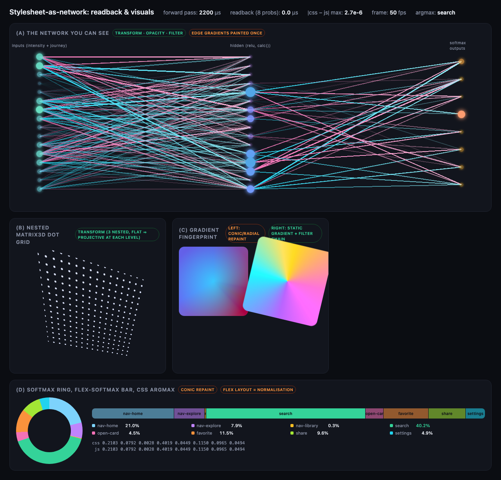

Research 2 built four visual layers and costed them. The expensive one is the network you can see (248 elements, ~1.5 ms per frame of style cost, with a ~700 µs fixed component once edges with `will-change` exist that was not isolated). Everything inside the net's subtree is re-styled on every input change (0.28 µs per element even with no `var()`; `display: none` does not skip an element's own style). The cheapest "alive" visual is the nested `matrix3d` dot lattice: one painted gradient, three `will-change: transform` wrappers, negligible CPU. The gradient fingerprint comes in a CPU flavour (conic/radial repaint per change) and a GPU flavour (static gradient, animated only through a `filter: hue-rotate() saturate() contrast() brightness()` chain plus a transform). The app shipped the GPU fingerprint as `PatternLayer` and the lattice as `DotGrid`.

---

## Architecture of smart-web

```
src/signals/   52 raw features per interaction -> 15 model inputs (7 pointer z-scores + last-action one-hot)
src/model/     Web Worker: Markov + MLP (15-16-8), online SGD, blend, IndexedDB, export/import
src/cssnet/    the CSS engine: generate.ts (stylesheet from NetShape), index.ts (calc | hybrid | animation),
               reference.ts (JS forward pass), visual/ (PatternLayer, DotGrid), parity.check.mjs
src/app/       HeroUI screen, adaptive grid, suggestion panel, debug drawer, replay, window.__smartweb
src/cssnet/contract.ts   the shared contract (ACTIONS, NetShape, CssNet, test hook, data-testids)
```

**The three engine modes** (from `MODE_NOTES` in `src/cssnet/index.ts`):

- `calc`: hidden layer, logits, max-shifted softmax and argmax flags as `calc()` on one element. JS writes inputs and weights as custom properties, reads results. Default.
- `hybrid`: the hidden layer in the animation engine (one paused animation per weight, `composition: add`); relu, output layer and softmax are `calc()` on the same element. Inputs saturate outside [-4, 4].
- `animation`: both weighted layers and the relu in the animation engine via the em bridge and the nested inherited-composition chain; only the softmax division is `calc()`. relu saturates at `h = 16`.

A detail that mattered: keyframes that reference weights as custom properties (`to { --h: var(--w) }`) **work** (a new, verified finding) but cost 1.6–2.4 ms per eval because Blink re-resolves `var()` in keyframes and copies the inherited property map down the chain. So the animation modes bake weights as literals, which makes `setWeights` a `<style>` rewrite (2.3 ms for 368 keyframes in animation mode). The app calls `setWeights` on every model snapshot, so a click in animation mode costs about 3.5 ms of engine time. That shows up as a few ms in the latency table below.

**Bridge and fallback.** `src/app/cssnetBridge.ts` mounts the CSS net with a mount-time probe (with zero weights every output must read 1/8); if the environment does not compute registered custom properties (jsdom, or a browser without `@property`, `exp()`, `linear()` or `animation-composition`), it throws and the app uses the JS net. The debug drawer prints which one is active: `net: cssnet (calc) · reference: cssnet/reference`.

**Visuals.** `PatternLayer` is a full-viewport static gradient animated only through compositor properties, fed 6 hidden activations. `DotGrid` is the three-level `matrix3d` lattice fed 16 hidden activations. Both update in ~260 µs per activation write (32 `setProperty` calls plus a style recalc).

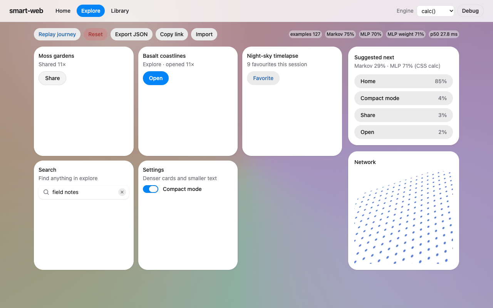

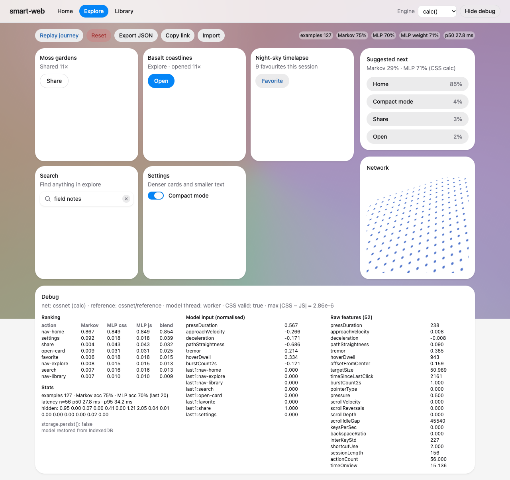

---

## How learning works

Everything model-side runs in a Web Worker (`src/model/worker.ts`), with a same-thread fallback.

**Markov.** An 8×8 transition table with decay 0.97 per row update and a prior strength of 1. It predicts `P(next | last action)`.

**MLP.** 15-16-8, relu, softmax, cross-entropy, online SGD with `lr: 0.1, l2: 1e-4, clip: 5`. The brief had asked for a "small" learning rate; 0.1 was chosen after a measurement on a 5-step cycle: lr 0.05 reached only 0.65 rolling top-1 after 150 steps, lr 0.1 reached 0.95 by step 125.

**Label delay.** When an interaction happens, the model predicts from the features *of that interaction* and stores the pair `{x, markov, mlp}` as pending. The *next* action is the label: both predictors' accuracies are scored against it, and one SGD step runs on `(pending.x, label)`. So the MLP learns "given how you just pressed *this*, what will you press *next*", which is the only way intensity can carry information about the future.

**Blend.** `alpha(n) = 0.85 · n / (n + 25)`, so Markov dominates early and the MLP's share climbs to about 0.7 after ~130 examples. Several session findings below are about the fact that alpha depends on the example count only, not on which predictor has been right.

**Normalisation.** A running Welford normaliser per pointer feature, seeded with an assumed desktop-mouse prior worth 20 pseudo-observations and a floor on the standard deviation. This was added after the e2e suite found that, without it, a near-constant feature got a near-zero spread and timer jitter of a few milliseconds became z = -2.73; two runs of the same calm journey then differed by L1 0.71 in output. With the prior they differ by about 0.004. The prior values are assumed, not fitted.

**Guardrails on the grid** (`src/app/adaptive.ts`):

- The grid does not move until more than 3 training examples exist (`COLD_START`).
- It is ordered by an EMA of the blended scores (`GRID_EMA = 0.25`), not the instantaneous prediction. Before this, a 4-step cycle swapped open-card and favorite on every interaction and a test click missed its moving target.
- At most **one** element moves per interaction, and only if its score beats its prior by 0.06 and the element it displaces by 0.03.

**Persistence.** Saves to IndexedDB (`idb-keyval`) are debounced to 1 s. Export as a JSON file (exact) or an int8-quantised URL fragment (~700 characters, lossy). A rolling top-1 accuracy over the last 20 examples is kept for each predictor.

---

## Results from the e2e suite

Final run: **18 Playwright tests passed in 6.1 minutes** (4 in the original `app.spec.ts` and 14 across 8 concept-level specs). `npm run typecheck` passes and covers `e2e/`; `npm test` passes 61 Vitest tests; `npm run build` passes with a warning that the bundle is over 500 kB. Metrics are written to [`reports/e2e-metrics.json`](e2e-metrics.json); screenshots to `reports/screens/`.

**CSS vs JS parity, in the running app** (10 real interactions per mode, max abs difference on the 8 probabilities):

| mode | max abs diff | tolerance |
|---|---|---|
| calc | 2.0e-6 | 1e-3 |
| hybrid | 1.0e-6 | 1e-4 |
| animation | 1.8e-6 | 1e-4 |

**Learning** (journey `nav-home → nav-explore → open-card → favorite`, realistic pointer input):

| repetition | examples | Markov rolling acc | MLP rolling acc |
|---|---|---|---|
| 1 | 4 | 0.25 | 0.00 |
| 2 | 8 | 0.50 | 0.125 |
| 3 | 12 | 0.67 | 0.25 |
| 5 | 20 | 0.80 | 0.35 |
| 7 | 28 | 1.00 | 0.50 |
| 8 | 32 | 1.00 | 0.50 |

Markov passed 0.6 on the 3rd repetition. After each step of a further repetition the top suggestion was the correct next action.

**Intensity, two journeys.** The same 4-step journey driven calmly twice and rushed once (24 examples each). MLP outputs after training: calm vs rushed differed by **L1 0.47**; calm vs a second calm run by **0.004**. Weights differed by 19.0 vs 0.045. Markov accuracy was 0.95 in all three (it cannot see intensity), MLP 0.30–0.35.

**Intensity decides where history cannot.** The user favourites after a *calm* open-card and shares after a *rushed* one. Markov stays near 50/50 on this (final: favorite 0.47 vs share 0.48 after calm; 0.50 vs 0.46 after rushed). The MLP learned it: after 12 cycles, favorite beat share by **0.77** after a calm press and share beat favorite by **0.80** after a rushed press (final MLP after calm: favorite 0.79; after rushed: share 0.82).

**Click-to-pixel latency** (pointerup → rAF + postMessage after the React commit of the new prediction, n=24 per mode):

| mode | GPU headless (`--use-angle=metal`) p50 / p95 / max | SwiftShader (default headless) p50 / p95 / max |
|---|---|---|
| calc | **31.2 / 33.8 / 52.5 ms** | 96.6 / 122.3 / 146.6 ms |
| hybrid | **35.3 / 46.7 / 59.6 ms** | 96.5 / 120.0 / 141.5 ms |
| animation | **36.1 / 46.0 / 57.6 ms** | 97.6 / 121.4 / 124.8 ms |

The 50 ms target only holds on a real GPU. Under SwiftShader, the full-viewport `PatternLayer` filters cost about 100 ms per frame; with all visuals hidden the SwiftShader p50 was 27.5 ms. On macOS the suite launches Chromium with `--use-angle=metal` (WebGL reports "ANGLE Metal Renderer: Apple M2 Pro"); `SMARTWEB_SOFTWARE_GL=1` runs the software path and the latency tests are marked expected-fail there. Hybrid and animation p95 sit close to the limit, with single samples at 57–60 ms, so those tests may be flaky on a loaded machine. Not tested on Linux.

**Guardrails.** On an 18-step `settings → share → search` cycle: zero moves during cold start (first 3 interactions), then at most one grid element per interaction (the recorded `movedPerInteraction` is all 0s and 1s). Note what that *also* means: one move on almost every interaction.

**Persistence.** Reload restored identical stats and weights (12 examples, same ranking); reset returns to the prior. JSON export imports exactly. The URL fragment (706 chars, 8798 bytes as JSON) imported into a fresh context with max score error 3.2e-4 and max weight error 9.3e-3; it swapped one ranking pair whose scores differed by 9.7e-8, so the test allows swaps only below a 0.01 gap.

**Visuals.** 5 of 6 tracked `PatternLayer` computed styles changed between two trained states, and the `DotGrid` corner points moved by up to 146 px.

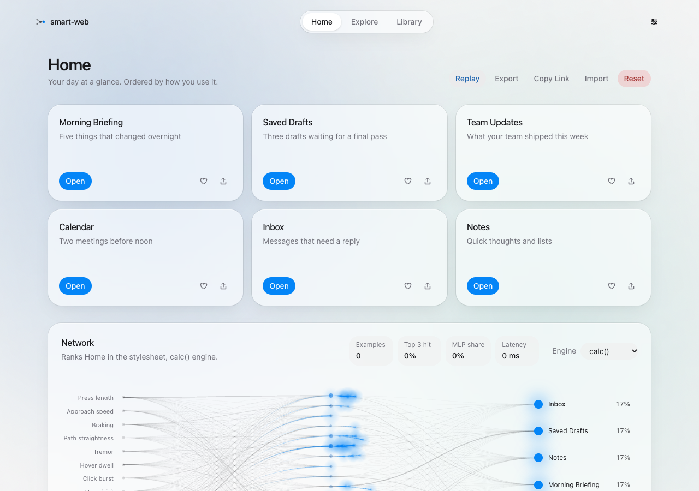

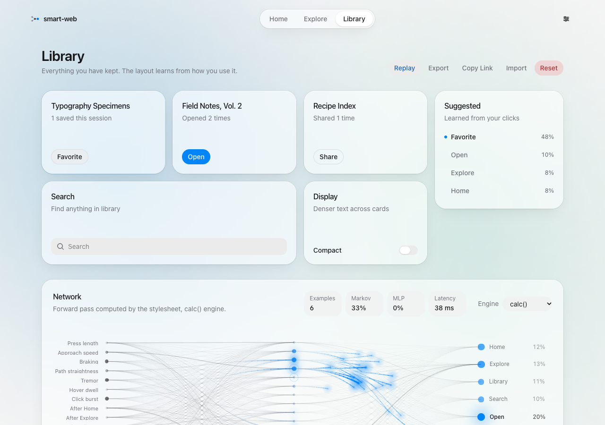

Three integration bugs were found and fixed by the suite rather than worked around: the grid thrash (fixed by the EMA), the missing cold-start guard, and a latency measurement that started at pointerdown (so it included how long the button was held) and ended a frame late. Vite was also reloading the page under test every time the metrics file was written; `reports/` is now ignored by the dev server's watcher.

---

## The four persona sessions

After the suite was green, four agents each drove the app as a scripted "person" with `page.mouse` and `page.keyboard` only (eased Bezier paths, overshoot, tremor, hover dwell, log-normal press times, think pauses, wheel scrolls, typed searches). Each sampled the full test hook after every interaction into a `trace.json`, and each wrote its own analysis. Everything here is from `reports/sessions/<persona>/`.

Shared setup: headless Chromium with `--use-angle=metal`, a fresh profile, `__smartweb.reset()` before the first click, and the engine confirmed as `cssnet` throughout. Three of the four ran concurrently on the same machine, which is a plausible (assumed) reason for some latency spread.

| persona | interactions | first adaptation at | Markov acc (app, final rolling-20) | MLP acc (app, final) | latency p50 / p95 ms | max CSS–JS diff | grid moves |
|---|---|---|---|---|---|---|---|
| methodical | 127 | #6 | 0.75 | 0.70 | 27.2 / 34.3 | 4.5e-6 | 40 |
| frustrated | 169 | #3 | 0.60 | 0.55 | 27.8 / 34.4 | 4.1e-6 | 8 |
| explorer | 124 | #3 | 1.00 (last 16, own count) / 0.75 (app) | 0.69 | 33.8 / 826 (see bug) | 3.3e-6 | 32 |
| returning | 123 | #2 | 0.70 | 0.65 | 29.3 / 36.3 | 3.4e-6 | 14 |

### 1. Methodical: the same five things every morning

Routine `home → explore → open-card → favorite → share` for 26 cycles, with a 20% chance of a deviation from cycle 3 (6 happened), 11 clicks made through the suggestion panel, and one reload at #72. Report: [`sessions/methodical/report.md`](sessions/methodical/report.md); video: [`session-trained.webm`](sessions/methodical/session-trained.webm).

**Measured.** The suggestion panel's top item was correct from #6 and then right 19 times in a row until the first deviation at #25. Suggestion top-1 was 0.93 on routine steps and 0.88 overall; per 20-interaction window it was 0.95–1.00 from #60 to #99. The MLP read from CSS went from 0.05 (#0–19) to 0.60 (#20–39) to 0.85–0.95 from #40. The grid first moved at #23 and then **never settled**: 40 moves in 127 interactions, 6–9 per 20 interactions to the end. In 37 of 76 grid clicks the target was in a different slot from the user's previous click. Nothing moved during a hover; no click missed. Latency p50 27.2, p95 34.3, max 43.9 ms.

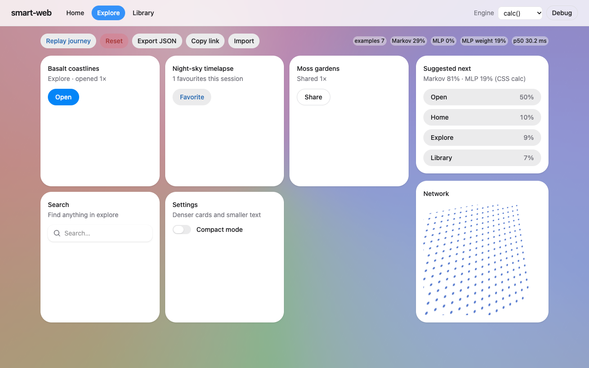

**The verdict, in the persona's words** (the agent's reading of measured behaviour, not a human opinion): *helpful, not creepy* about suggestions; the grid *jumpy, not broken, just restless*. "Being more predictable made the layout less stable, which is backwards for someone like me."

**Bugs found.** (1) A reload within ~1 s of an action loses that example (6→5 at 200 and 600 ms; 6→6 at 1500 and 2500 ms). The 1 s save debounce with no `pagehide` flush is the assumed cause. (2) Grid order is not persisted; every reload replays the default order. (3) One typed search is recorded as **two** actions when Enter comes more than 1.5 s after the click into the field (click + Enter after 2000 ms: 2 examples; after 300 ms: 1). At #124 this taught the model `search → search` and the real next action ranked 7th of 8. (4) The blend let a wrong MLP override a correct Markov twice (#59, #112).

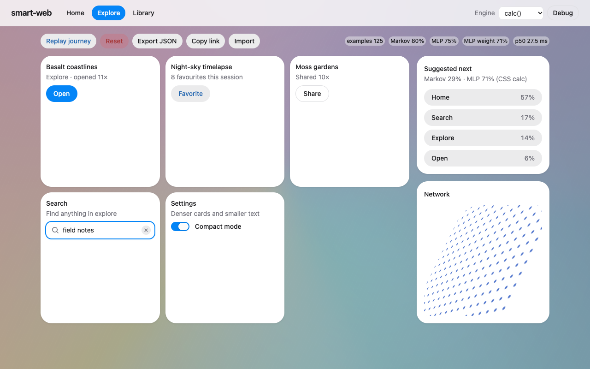

### 2. Frustrated: rage bursts on "Open"

The same goal loop with 3–6 press rage bursts on Open, 2–3 angry Compact-mode toggles after each burst, Library↔Explore bouncing, jerky scrolling, typo-heavy search, and the engine switched to hybrid and then animation mid-session. 24 cycles, 169 presses, 166 examples, 162 s. Replicated with a second seed. Clip: [`clip-rage-and-reorder.webm`](sessions/frustrated/clip-rage-and-reorder.webm).

**Measured: intensity changes suggestions.** Predictions made right after an Open press, second half of the run, where Markov's input is identical in both cases:

| after an Open that was... | what the persona did next | MLP P(favorite) / P(open) | Markov P(favorite) / P(open) |
|---|---|---|---|
| calm (9 cases) | favorite 9/9 | **0.55 / 0.15** | 0.22 / 0.58 |
| a rage burst (19 cases) | Open 15, Compact 4 | **0.05 / 0.71** | 0.24 / 0.59 |

Markov's top-1 on the calm case was 0.00; the MLP's was 0.89. The second seed agrees (calm MLP P(fav) 0.56, rage 0.037). The MLP carries the intensity signal: press-duration z about +1.2 vs -0.86, burst count z about -0.64 vs +0.49.

Accuracy climbed in 25-press windows from 0.40 (blend) at the start to 0.80 around #101–125; overall blend 0.66, Markov 0.66, MLP 0.53. The ceiling is about 0.7 because the persona's own choices are coin flips. Latency p50 27.8 / p95 34.4 ms; by mode p50/p95 calc 27.2/34.7, hybrid 28.0/48.7, animation 27.5/33.6. Parity at most 4.1e-6 across all three modes. 8 grid reorders, none moving more than one element, none moving a target more than 8 px during an aimed approach.

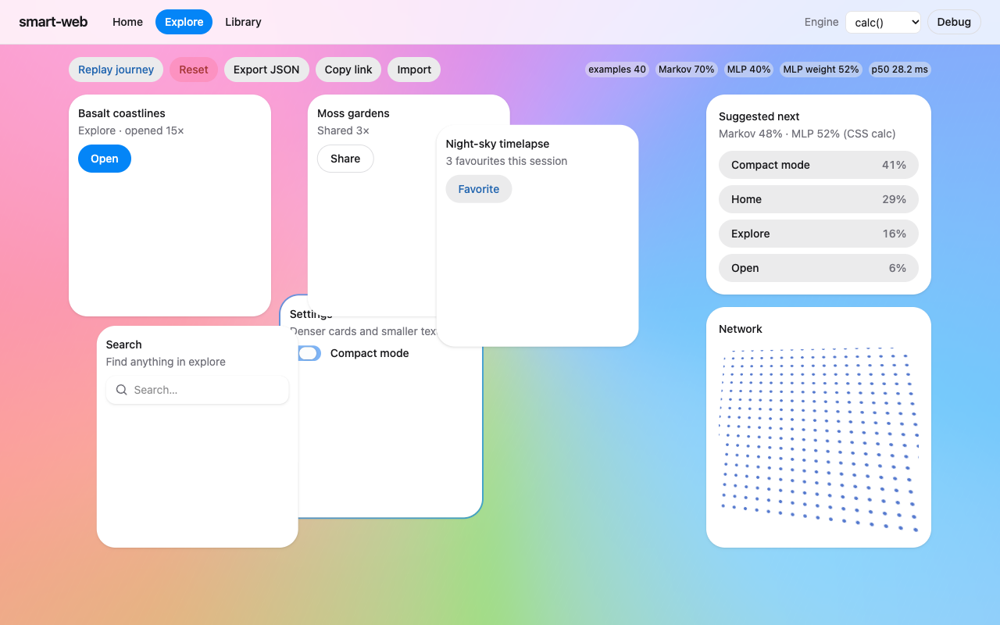

**The verdict:** *jumpy and somewhat mocking when angry, helpful when calm, not creepy.* After a rage burst the top suggestion is "Open" again, the button that "isn't working". After angry toggling it suggests "Compact mode 41%" and promotes Settings to slot 1, treating the tantrum as a preference. The calm-path Favorite suggestion "felt genuinely smart: it noticed how I clicked, not just what."

**Bugs found.** (B1) Toggling Compact mode makes the Settings card *taller* (195 → 284 px) and moves the switch itself from y=378 to y=481, so a second toggle in place misses; 5 of 25 angry toggles were lost. (B2) The grid reorders during a burst and the next press lands on the Search input mid-spring, which is then learned as a `search` action (seen in both seeds). (B3) Keyboard-triggered actions report latencies up to 2 s because the timer starts at the earlier pointerup on the input (1163 ms with 6 characters at 150 ms per key). (B4) The same double-counted search as above. (B5, design) Every rage press is its own training example, so Markov learns `open → open` at ~0.58 regardless of intensity. (B6) Open-card and favorite swapped 6 times in 21 presses under Library/Explore bouncing.

### 3. Explorer: 60 random clicks, then a habit

Interactions 0–59 uniform random over the 8 actions; 60–123 repeat `nav-explore → open-card → share → search`. Two seeds. Clip: [`explorer-clip.webm`](sessions/explorer/explorer-clip.webm).

**Measured, random phase.** The top suggestion was right 8.3% (seed 1234) and 15% (seed 99) of the time; random guessing over 8 gives 12.5%. Yet the panel showed a mean top probability of 31% and 29%, peaking at 67% and 73%. When it showed 40–60% it was right 1 in 12 and 0 in 8 times. It suggested repeating the action just done 25 of 59 times. The grid moved only 9 and 7 times, which is calm.

**Measured, pattern phase.** Markov was right 4 in a row from #81 and #69 (pattern starts at #60); the top suggestion from #85 and #83. Over the second half of the pattern, Markov top-1 was 1.00 in both seeds, the MLP 0.66 and 0.56, the blend 0.84 and 0.78. And then the grid churned: 14 and 16 moves in the last 32 interactions while Markov was 100% correct.

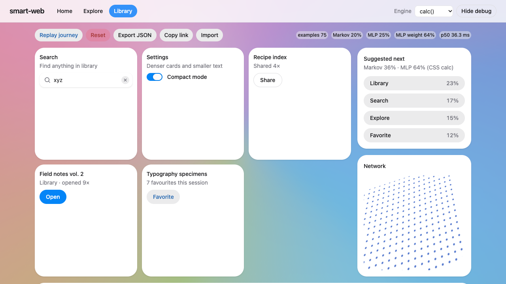

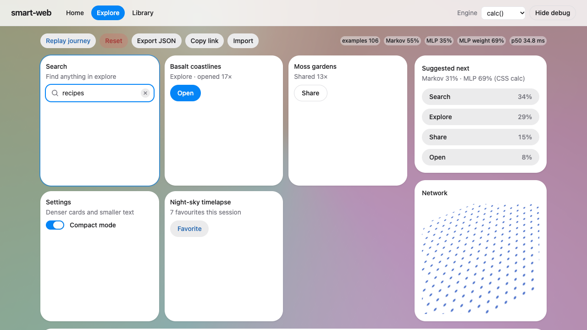

Latency: all interactions p50 33.8, p95 826 ms; **excluding searches** p50 33.0, p95 44.5, max 58.3 ms. The 826 ms p95 is entirely the keyboard latency bug. Seed 99 excluding search: p50 47.4, p95 62.2 (assumed: machine contention from the other three sessions). Parity max 3.3e-6.

**The verdict:** suggestions *useless to misleading while exploring, wrong with a straight face rather than creepy*; layout *calm while exploring*; *genuinely helpful once a habit forms, but jumpy afterwards*, because Open, Share and Search swap places every other click.

**Bugs found.** Rage clicks become N training examples (rises of 5, 5, 4, 4, 3, 3 seen); the search double-count with a stale latency start (826–1972 ms, 7 times); overconfident cold start (`MARKOV_PRIOR_STRENGTH = 1` means one observed transition shows as ~53%); the grid moving on thin evidence (first move at 4 examples, after one repeated transition, because `COLD_START` checks only the total count); grid churn after learning; and a blend weight that grows with count only (0.73 at the end while the MLP was right 56–66% against Markov's 100%, overriding Markov wrongly at #92, #104, #114, #116, #121).

### 4. Returning: three sessions, one profile, and a share link

One persistent profile: S1 (calc) learns `Home → Search (typed) → Open → Favorite → Library` for 40 interactions; S2 resumes for 30 across calc, hybrid and animation; S3 switches to a new habit `Explore → Search → Open → Share` for 45; then the S3 share link is opened in a fresh profile (8 interactions), and the older S1 link is opened in the main profile. Video: [`session1-short.webm`](sessions/returning/session1-short.webm).

**Measured.** Persistence works when the close comes at least 1.5 s after the last action: 47/47 and 78/78 examples restored, log says "model restored from IndexedDB". Top-1 per phase, blend / Markov / MLP: S1 0.78 / 0.75 / 0.35; S2 0.83 / 1.00 / 0.70; S3 0.58 / 0.71 / 0.44; fresh profile 0.63 / 0.88 / 0.63. The suggestion panel was trusted and clicked 9 times in S2.

**Habit decay.** After the first Open of the new habit the app still suggested Favorite at 62%. The blend's top suggestion flipped to Share at the 8th Open, 30 interactions into the new habit; the MLP flipped at the 7th, Markov alone at the 11th. Decay is per transition only (0.97 per row update); there is no wall-clock decay (read in the code, not tested with a real gap).

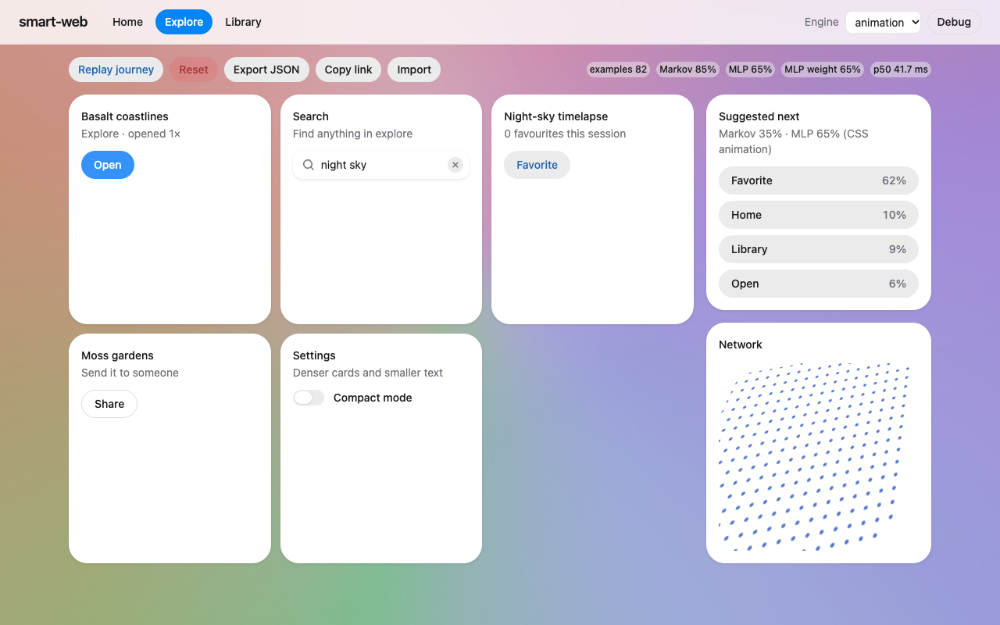

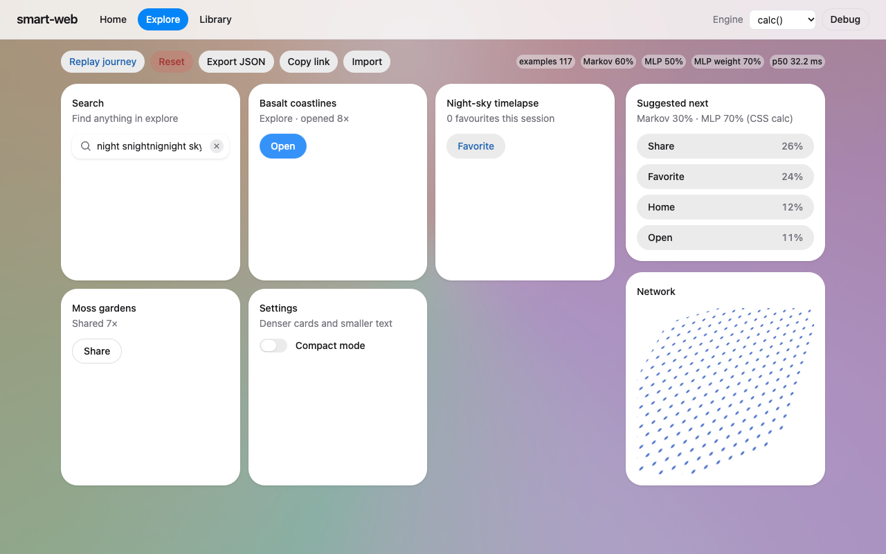

**Portability.** The link is 731 characters. In a fresh profile it imported 133 examples, Markov rows matched to 3.1e-5, and the hash was stripped from the URL. Missing after import: the rolling accuracy chips read 0%/0%, and the grid uses the default order.

**Modes.** Parity at most 3.4e-6 in all modes. Latency p50/p95: calc 27.6/38.4, hybrid 28.5/34.7, animation 30.9/37.5 ms. Switching through the dropdown kept `netSource = cssnet` every time. "As a user I could not see any difference between the modes." Accuracy differences between modes are confounded with session phase and are not attributed to the engines.

**The verdict:** *helpful once warm, not creepy, mildly jumpy* (every session start shows a wrong "Open" suggestion and replays the same 4-card reshuffle), *stubborn about unlearning* (about 30 clicks to accept the new habit). "The silent model overwrite through an old link is the one thing that would break trust."

**Bugs found.** The double search (20 of 20 typed searches); keyboard latency timed from the earlier pointerup (1521–1906 ms); the **first suggestion of every session is wrong** because at load the MLP is fed idle features no real press produces (pressDuration z = -4, hoverDwell z = -3.8) and answers open-card at 0.79–0.93, outvoting a correct Markov (3 of 3 loads); closing within 1 s loses the last action (`quickclose.json`: 1 of 6 lost at 100/400/800 ms, 0 at 1500/3000 ms, 3 of 6 lost for a burst closed 100 ms later); **opening a share link silently replaces the local model** (133 examples became 47 with no confirmation or undo); a share link opened in an already-open tab does nothing until the next reload, when it imports over everything trained in between; grid order, EMA scores and engine mode are not persisted; the URL fragment carries no rolling accuracy.

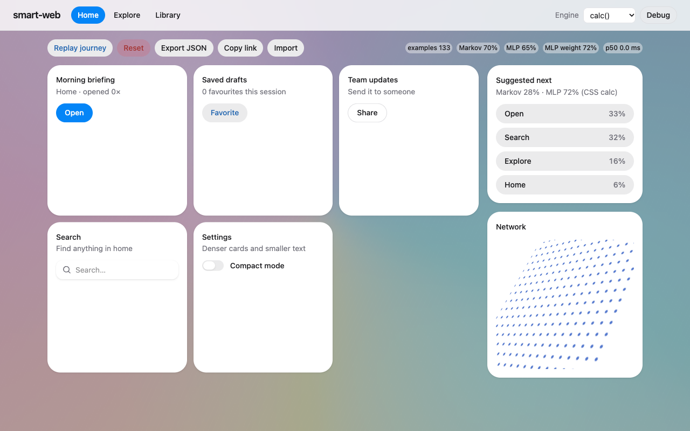

### What all four agree on

- The **suggestion panel** adapts within a handful of interactions on a routine and was described as helpful by three of four personas. Nobody called it creepy; the consensus was that it visibly reflects only the user's own clicks.
- The **MLP really does use intensity** (frustrated, e2e branching test), and is otherwise a weaker action predictor than Markov on plain cycles.
- The **grid never stops moving** on a stable routine, because it is ordered by the *next-action* distribution, which by construction rotates through a cycle. The guardrail (one move per interaction) holds everywhere; it just means one move per interaction.
- The **same three bugs** were found independently by every persona: the double-counted typed search, the keyboard-triggered latency measured from the wrong event, and the one-second save debounce with no flush on unload.

---

## What failed or surprised

- **The GPU does nothing for the net.** Expected by the people who read the Chromium docs, still a letdown. The forward pass is style recalc on the main thread, ~300 µs minimum.
- **The animation engine *can* be the whole net**, and the trick is laundering a number through `font-size` and reading it back as `1em / 1px`. Nobody planned that. The gotcha (producer and consumer must be different elements, because `em` in `animation-*` resolves from the element's own pre-animation style) cost a real failed run first.
- **Recurrence is impossible in CSS.** Cycles are invalid, descendants are invisible to ancestors, and there is no state cell. A stylesheet is a feed-forward network. Time-multiplexing with `steps()` works but only forward.
- **Property-weight keyframes work but are slow** (1.6–2.4 ms per eval); the animation modes bake literals and pay for it in `setWeights` instead.
- **`getComputedTiming().progress` ignores easing**, so the Web Animations API cannot read an activation, only its input.
- **Headless Chromium's default renderer (SwiftShader) made the app miss its latency target by 3x**, entirely because of a decorative full-viewport filter layer. The fix was a launch flag, and a note that Linux CI would need either software-GL expected-fails or a cheaper background.
- **The normaliser amplified timer jitter** into z-scores near -3 before a population prior was added. The prior is a guess.
- **Intensity signals leak into the UI in ways the designers did not intend:** rage on Open teaches the app to suggest Open; angry toggling of Compact mode promotes Settings. The model is doing exactly what it was asked; what it was asked is the problem.
- **A click on the search field counts as a search, and so does pressing Enter**, 1.5 s later. Four independent sessions found this on their first typed query.
- **Replay feeds synthetic pointer data straight into the extractor** rather than dispatching DOM events; rage bursts in the replay collapse to one action. Real input during a replay mixes into the same timeline.
- **Two agents hit a harness limit** on writing their `report.md` and returned the content as text instead; those reports exist only as the findings quoted here and their committed data. One agent also noted that `*.log` is gitignored, so its `run.log` link only works locally. The commit trailer model name also varies between commits because two instructions disagreed.

---

## What to try next

Ordered roughly by how many sessions asked for it.

1. **Count a search once** (on submit, or on click only if nothing is submitted within N seconds).
2. **Start keyboard-fired latency at the keydown**, not the last pointerup.
3. **Flush the model save on `pagehide` / `visibilitychange`**, and persist grid order, EMA scores and the engine mode.
4. **Stop the grid from following the cycle.** Order it by a long-horizon frequency signal and leave "what's next" to the suggestion panel; or add a per-card move cooldown; or lock the order once it has repeated for K cycles; or freeze it while `burstCount2s >= 3` or while the pointer is over the grid. (All untested.)
5. **Collapse a press burst into one example**, or down-weight presses 2..n, so rage does not teach `X → X`.
6. **Set the blend weight from recent relative accuracy** (rolling log-loss of each predictor), not from the example count.
7. **Use Markov only for the first prediction after a load**; the MLP's idle-feature input is meaningless there.
8. **Ask before importing a share link** over an existing model, add an undo, and listen for `hashchange`.
9. **Raise `MARKOV_PRIOR_STRENGTH`** (4–8 was suggested) or hide percentages while the state has little history.
10. Add **time-aware decay** so a week-old habit weighs less than yesterday's.
11. Make the **Compact switch not move itself**, and give Open visible feedback (it is what triggered the rage persona).
12. Engineering levers for the CSS engine if it ever needs to be cheaper: `literalWeights: true` in calc mode (221 µs), hidden width 8, or drop `will-change` on any visible-network edges and re-measure the ~700 µs fixed cost.
13. **Test with a human.** Every verdict above is an agent reading a trace.

---

## How to run it locally

```bash
cd smart-web
npm install
npm run dev            # http://127.0.0.1:5173 — click around, open "Debug", switch Engine
npm test               # Vitest: 61 unit tests (jsdom; the CSS net falls back to JS there)
npm run typecheck      # tsc -b, includes e2e/
npm run build
npm run e2e            # Playwright, 18 tests, ~6 min, starts the dev server itself on 5173,
                       # writes reports/e2e-metrics.json and reports/playwright/
SMARTWEB_SOFTWARE_GL=1 npm run e2e   # software GL; latency tests are expected-fail there
node src/cssnet/parity.check.mjs     # CSS vs JS parity + timing for all three modes, no server needed
```

Persona drivers (each needs its own dev server on its own port, as the file headers say):

```bash
npx vite --port 5181 --strictPort &  node reports/sessions/methodical/session.mjs
npx vite --port 5182 --strictPort &  node reports/sessions/frustrated/session.mjs
npx vite --port 5183 --strictPort &  node reports/sessions/explorer/session.mjs
npx vite --port 5184 --strictPort &  node reports/sessions/returning/session.mjs
```

Research demos that need no server: open `research/experiments/r1-best-demo.html` (the zero-JS animation-engine net) and `research/experiments/r2-visual-demo.html` in Chrome; the `r1-*.mjs` / `r2-*.mjs` scripts run with `node research/experiments/<name>.mjs` from the project root.

In the app: `Replay journey` trains on a seeded synthetic journey, `Reset` clears IndexedDB, `Export JSON` / `Copy link` / `Import` move a model between browsers, the `Engine` select switches calc / hybrid / animation live, and `Debug` opens the drawer with the CSS-vs-JS difference, both rankings, and all 52 raw features. `window.__smartweb` is the test hook from `src/cssnet/contract.ts`.

---

*Everything in this post comes from files committed in the repository on 2026-10-22. Where a number was not measured, the text says "assumed". The research, implementation, test and persona work was done by separate agents working from a shared contract; this write-up is the reader's digest of their reports.*
