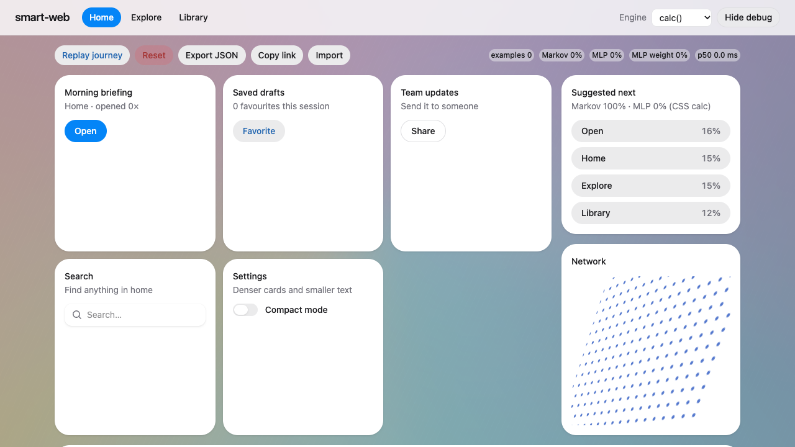
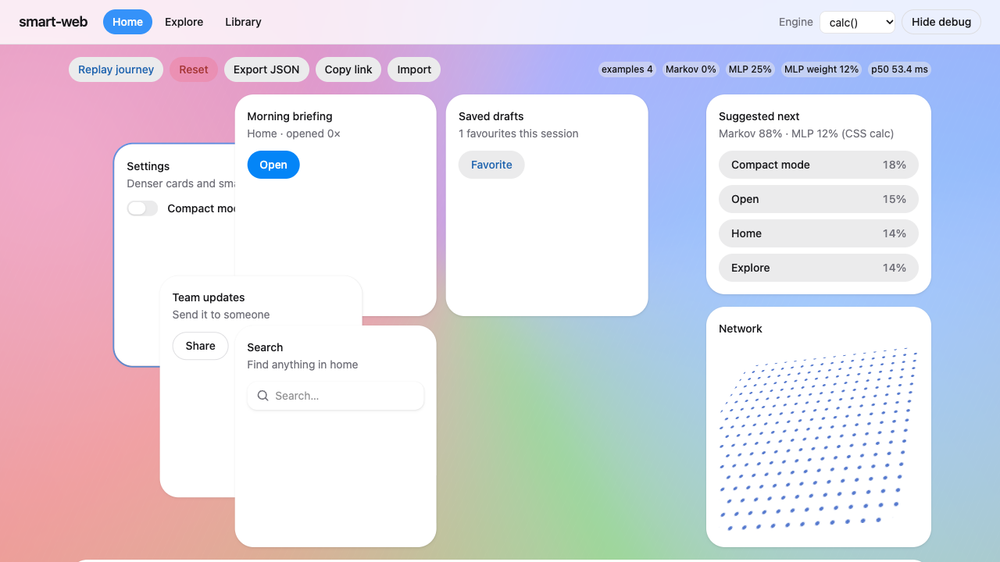
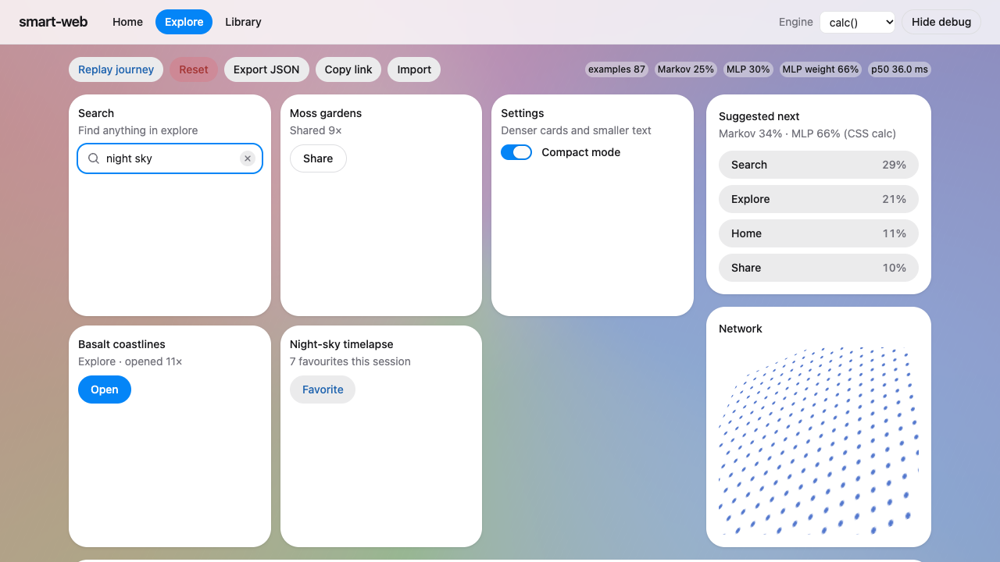
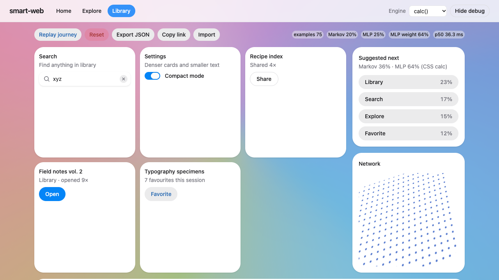
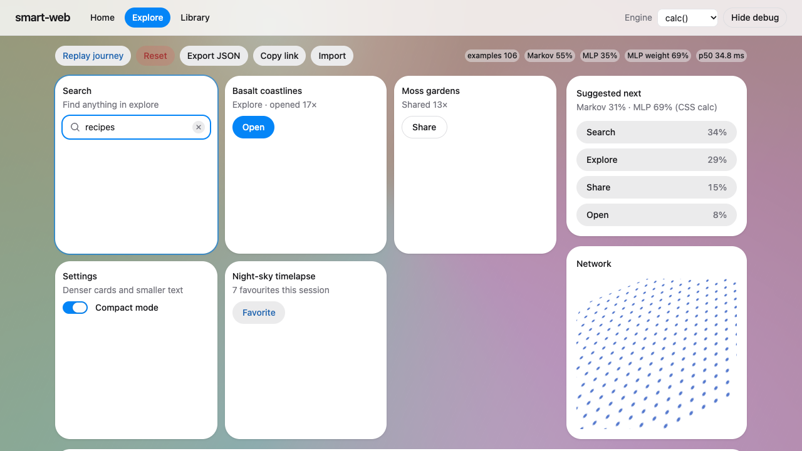
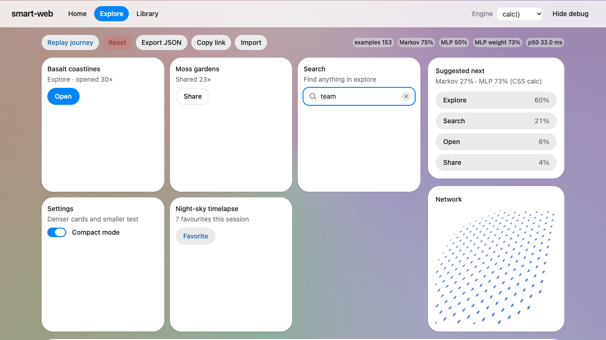
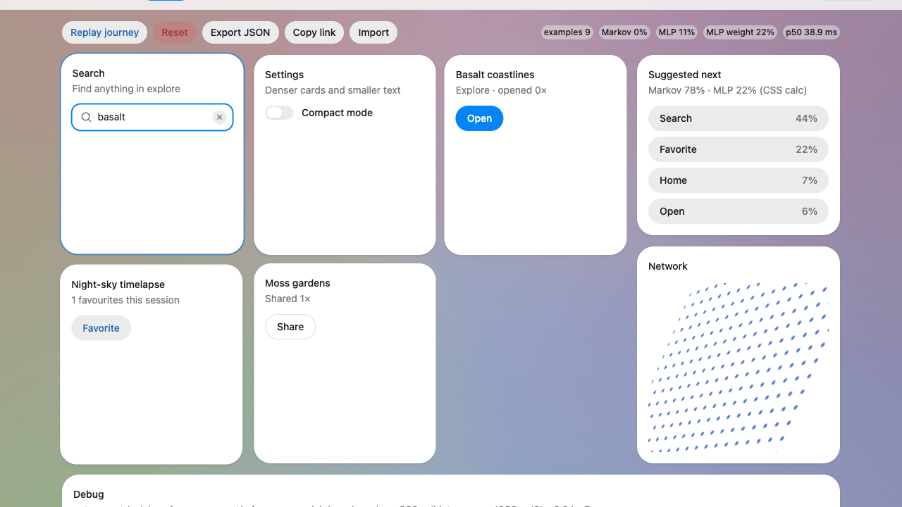
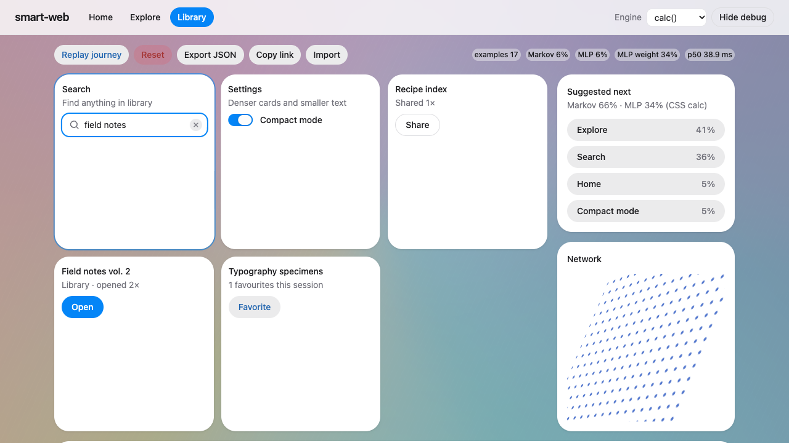
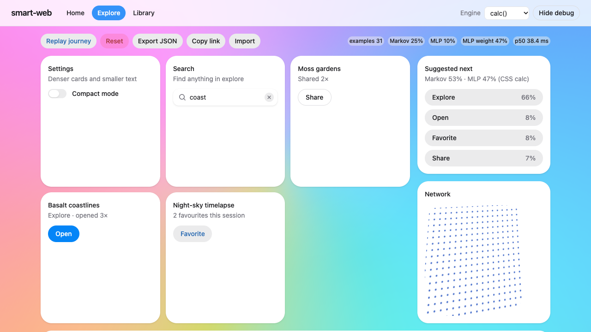
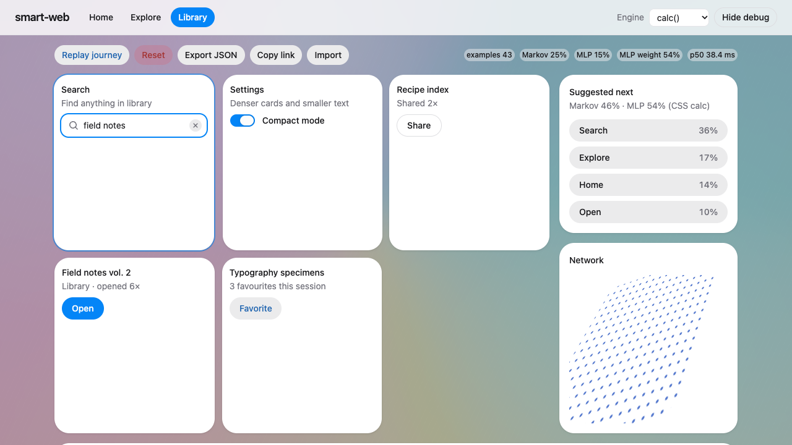

# Persona session: explorer

_Written by the orchestrator from the session agent's returned results; the agent was blocked from writing this file. Raw data: trace.json, metrics.json, session.mjs in this folder._

**Persona.** explorer

## Metrics

| Metric | Value |
|---|---|
| interactions | 124 |
| firstAdaptationAtInteraction | 3 |
| markovTop1AccFinal | 1 |
| mlpTop1AccFinal | 0.688 |
| latencyMsP50 | 33.8 |
| latencyMsP95 | 826.4 |
| cssJsMaxAbsDiff | 3.34e-06 |
| layoutMovesTotal | 32 |

## Findings

- Report location: I did not write report.md because the harness blocked it. This list is the report's content. Everything else is committed as 8c43e35, and only reports/sessions/explorer/ was added: session.mjs, analyze.mjs, trace.json, metrics.json, run.log, 10 PNGs, explorer-clip.webm (55 s, 3.1 MB) and a replication run in seed99/. I deleted the full 72 MB recording after cutting the clip. I edited nothing under src/ or e2e/. The dev server on port 5183 was killed (curl now returns 000).
- Answer to the question:
- The layout stays calm when there is no pattern.
- The suggestions do not avoid overconfidence.
- It picks up a pattern that starts halfway through within 2 to 6 cycles.
- Once the pattern is learned, the grid moves more often than before.
- Method:
- Headless Playwright Chromium at 1280x720 with --use-angle=metal; WebGL reported Apple M2 Pro. Model reset before the first interaction.
- Input: curved, eased mouse moves (some overshoot, some tremor), press times from about 10 to 600 ms, think pauses, 3 to 5 press rage bursts when rushed, heavy wheel scrolling (debug drawer open so the page scrolls), and typed search words with Enter 60% of the time.
- Interactions 0-59 are uniform random over the 8 actions. Interactions 60-123 repeat nav-explore, open-card, share, search.
- A hit means the prediction made before the interaction matched what the explorer then did.
- Run twice: seed 1234 (main run, with video) and seed 99 (no video).
- Only calc mode was tested. Input is synthetic; no human drove it.
- Random phase (60 interactions):
- The top suggestion was right 8.3% (seed 1234) and 15% (seed 99) of the time. Random guessing over 8 actions gives 12.5%.
- Yet it showed an average of 31% and 29%, with peaks of 67% and 73%.
- When it showed 40-60%, it was right 1 in 12 times (seed 1234) and 0 in 8 (seed 99).
- It suggested repeating the action just done 25 of 59 times.
- The top suggestion changed on 46 of 60 interactions.
- The grid moved only 9 and 7 times, which is calm.
- First visible adaptation was interaction 3 (a grid move).
- After a single settings-then-settings repeat, the panel showed 'Compact mode 53%'.
- At 4 training examples the Settings card jumped to the first slot.
- The screenshot 02-first-adaptation-003.png shows the cards overlapping mid-animation.
- The MLP gave 0.80 to favorite after only 8 random examples.
- Pattern pickup:
- Markov was right 4 times in a row from interaction 81 (seed 1234) and 69 (seed 99), with the pattern starting at 60.
- The top suggestion was right 4 times in a row from 85 and 83.
- Markov top-1 over the second half of the pattern was 1.00 in both seeds. The MLP's was 0.66 and 0.56, and the blended top-1 was 0.84 and 0.78.
- After the pattern was learned the grid churned: 14 and 16 moves in the last 32 interactions, while Markov was 100% correct. Total layout moves: 32 (seed 1234) and 26 (seed 99).
- Latency (calc mode, last value per interaction, seed 1234):
- All interactions: p50 33.8 ms, p95 826 ms.
- Excluding search: p50 33.0 ms, p95 44.5 ms, max 58.3 ms.
- The 826 ms p95 comes entirely from bug 2 below.
- Seed 99 excluding search: p50 47.4 ms, p95 62.2 ms. I assume, without having measured it, that this is because other persona agents were loading the machine at the same time.
- CSS vs JS: the largest difference was 3.3e-6 over all samples. The DOM grid order always matched gridOrder(), and there were no console errors.
- Hook stats() under-reports accuracy (markovAcc 0.75 against a measured 1.00 over the last 16 interactions) because the extra rage-click examples count as misses.
- What the explorer would say: suggestions feel useless to misleading while exploring, wrong with a straight face rather than creepy. The layout is calm while exploring. It is genuinely helpful once a habit forms, but jumpy afterwards, because Open, Share and Search swap places every other click.
- Fixes I would suggest:
- Collapse press bursts on one control into a single action.
- Start keyboard-fired latency at the keydown.
- Raise MARKOV_PRIOR_STRENGTH to 4-8, or shrink predictions toward the prior based on how often that state has been seen, and hide percentages while uncertain.
- Require enough history for the current state before the grid moves.
- Order the grid by long-run frequency and keep next-action for the suggestion panel only.
- Set the blend weight from the two rolling accuracies.
- Tested vs inferred: every number above is measured from the two runs. The causes of bugs 1 and 2 come from reading the source, not from a debugger, but the observed numbers match them exactly.

## Bugs

- BUG 1 (rage clicks become N training examples)
- Each press in a burst fires onPress, so stats().examples rises by the number of presses. Seed 1234 saw rises of 5, 5, 4, 4, 3 and 3. This teaches the model X-then-X transitions the user never meant.
- Effects: at interaction 24 the panel suggested 'Explore 66%' right after the user mashed Explore. At 121 the MLP gave 0.66 to nav-explore and outvoted a correct Markov prediction (open-card 0.64). It also deflates the hook's markovAcc.
- Repro: press action-nav-explore 5 times, 40-110 ms apart; examples rises by 5.
- BUG 2 (search plus Enter counts twice and reports a stale latency)
- Clicking the input fires 'search'. Pressing Enter more than 1.5 s later fires 'search' again, because the recentSearch guard in GridCard is 1500 ms.
- act() then takes t0 from fx.lastReleaseTime(now), which accepts a pointerup up to 2000 ms old. So the latency includes all the typing: 826-1972 ms measured, 7 times in seed 1234 and 3 in seed 99. The debug drawer showed p95 1417.8 ms.
- Repro: click action-search, type 6 characters about 200 ms apart, press Enter. examples rises by 2, and the last latencies() value is about 1.5-2 s.
- BUG 3 (overconfident cold start; a design issue)
- MARKOV_PRIOR_STRENGTH=1 means one observed transition shows as about 53% in the suggestion panel.
- In the random phase the mean shown top probability was 0.31 and 0.29, against hit rates of 0.08 and 0.15. In the 0.4-0.6 band the hit rate was 0.08 and 0.00.
- BUG 4 (grid moves on thin evidence)
- The first move came at 4 examples, based on one repeated transition. COLD_START=3 checks only the total example count, not how much history exists for the current state.
- BUG 5 (grid churns after the pattern is learned)
- The grid moved on 14 and 16 of the last 32 interactions while Markov was 100% correct. The cause is that the grid follows the next-action prediction, which rotates through the cycle by design.
- BUG 6 (blend weight ignores which model is right)
- alpha grows only with the example count (0.73 at the end). The MLP was right 56-66% of the time against Markov's 100%, so the blended top-1 is lower than Markov alone (0.78-0.84). The blend overrode Markov wrongly at interactions 92, 104, 114, 116 and 121 (seed 1234).

## Screenshots

