# Persona session: returning

_Written by the orchestrator from the session agent's returned results; the agent was blocked from writing this file. Raw data: trace.json, metrics.json, session.mjs in this folder._

**Persona.** returning: one person on one persistent profile. S1 (calc) learns Home > Search (typed) > Open > Favorite > Library for 40 interactions. S2 resumes for 30, split across calc, hybrid and animation. S3 switches to Explore > Search > Open > Share for 45 (animation, then hybrid, then calc). Then the S3 share link is opened in a fresh profile (8 interactions), and the older S1 link is opened in the main profile. 123 interactions, headless Chromium with --use-angle=metal, shared CPU with 3 other agents.

## Metrics

| Metric | Value |
|---|---|
| interactions | 123 |
| firstAdaptationAtInteraction | 2 |
| markovTop1AccFinal | 0.7 |
| mlpTop1AccFinal | 0.65 |
| latencyMsP50 | 29.3 |
| latencyMsP95 | 36.3 |
| cssJsMaxAbsDiff | 3.4e-06 |
| layoutMovesTotal | 14 |

## Findings

- REPORT NOT WRITTEN: the harness refused the Write of report.md. Everything else is committed as 3fbf4e7, using `git add reports/sessions/returning` only: session.mjs (driver), analyze.mjs (writes metrics.json), quickclose.mjs and quickclose.json, trace.json, metrics.json, 12 PNGs and session1-short.webm (45 s, 384 kB, re-encoded with ffmpeg). The vite dev server on 5184 was started and killed. Nothing under src/ or e2e/ was touched.
- METHOD: headless Playwright launchPersistentContext in a temp directory, closed and reopened between sessions, seeded RNG. The pointer moves on eased (cubic in-out) curved Bezier paths of 10-36 steps with overshoot. Hover dwell, press length (median 115 ms) and think time are all log-normal, and think time shortens as the routine becomes familiar. 12% of interactions include an idle wheel scroll. Searches are typed key by key and submitted with Enter. In S2 the user clicks the suggestion 35% of the time when it is right. Before each press, elementFromPoint checks whether the target moved. 'Hit' = the prediction shown BEFORE the press (ranking()[0], argmax markov(), argmax cssOutputs()) equals the action pressed.
- FIRST ADAPTATION: the grid first moved at interaction #2: Search jumped to slot 1 and 3 other cards shifted. The screenshot catches the cards overlapping mid-spring (s1-first-adaptation.png). The first correct top suggestion was at #6 (Search after Home) and the first 3 hits in a row at #10.
- ACCURACY: my per-interaction top-1 for S1 / S2 / S3 / fresh. Blend (top suggestion): 0.78 / 0.83 / 0.58 / 0.63. Markov: 0.75 / 1.00 / 0.71 / 0.88. MLP: 0.35 / 0.70 / 0.44 / 0.63. The app's rolling-20 at the end was Markov 0.70 / MLP 0.65 at 133 examples (1.00 / 0.75 at the end of S2).
- PERSISTENCE: tested and working when the close comes at least 1.5 s after the last action. 47 of 47 and 78 of 78 examples were restored, and the log says 'model restored from IndexedDB'. NOT persisted: the grid order and grid EMA scores (reset to the default on every load) and the engine mode (always calc on load).
- HABIT DECAY (S3): after the first Open of the new habit the app suggested Favorite at 62%. After Open, the blend's top suggestion flipped to Share at the 8th Open, 30 interactions into the new habit. The MLP flipped at the 7th Open and Markov alone at the 11th (P(share) 0.483 vs P(fav) 0.472). Decay is per transition only (0.97 per row update). I read in the code, and did not test, that there is no wall-clock decay: weeks-old habits weigh the same as yesterday's.
- PORTABILITY: tested. The link is 731 characters. In a fresh profile it imported 133 examples, the Markov rows matched to 3.1e-5, and the hash is stripped from the URL. Missing after import: the rolling accuracy chips show 0%/0% and the grid uses the default order. The fresh profile hit 5 of 8.
- MODES: parity was at most 3.4e-6 in all modes. Latency p50/p95 was calc 27.6/38.4, hybrid 28.5/34.7, animation 30.9/37.5 ms. Switching through the dropdown kept netSource=cssnet every time. The accuracy differences between modes are confounded with session phase (animation got the start of the habit change), so they are not attributed to the engines. As a user I could not see any difference between the modes.
- LATENCY: p50 29.3 / p95 36.3 / max 53.4 ms over n=103. 20 typed searches were excluded as a measurement artefact (bug 2); they read 1.5-1.9 s.
- LAYOUT: 14 grid moves in total (11 on the main profile, 3 on the fresh one). 4 of them shifted 3-4 cards; the rest were adjacent swaps. There were 2 oscillations where the same two cards swapped back within 5 interactions (#27/#32 and #62/#65/#67). There were 0 re-aims: the target was never moving under the pointer.
- PERSONA VERDICT: helpful once warm, and the suggestion panel was trusted and clicked 9 times in S2. Not creepy: it only reflects the user's own clicks. Mildly jumpy: every session start shows a wrong 'Open' suggestion and replays the same 4-card reshuffle. Stubborn about unlearning: about 30 clicks to accept the new habit. The silent model overwrite through an old link is the one thing that would break trust.
- SUGGESTIONS: (1) fix the double search; (2) persist the grid order, and do not shuffle on the first click after load; (3) use Markov only (alpha 0) for the first prediction after load; (4) add a hashchange listener plus a 'replace your model?' confirmation with an undo; (5) add time-aware decay, or faster decay for a row that keeps missing; (6) add a per-card move cooldown; (7) flush the model save on pagehide/visibilitychange.
- TESTED VS ASSUMED: all metrics, the quick-close loss, the link import and the old-link overwrite were executed. The root causes named in bugs 1-4, 6 and 7 ('no time decay', 'no hashchange listener', the 1500 ms dedupe, the 1000 ms debounce, idle features feeding the MLP) were read from the code, not instrumented. Not tested: other browsers, SwiftShader, whether a pagehide flush would complete during unload, and a real multi-day gap between sessions (sessions were about 1.5 s apart). Driver quirk: the S3 query was always 'night sky' because of a modulo collision in the script. Another agent overwrote my console log file in the shared scratchpad; trace.json is complete and was not affected.

## Bugs

- BUG 1 (high): a typed search is recorded as TWO search actions. Repro: click the search input (onClick fires act('search')), type a word, press Enter more than 1.5 s after the click (onSubmit fires doSearch again). stats().examples goes up by 2. This happened in 20 of 20 typed searches. The time-based 1500 ms dedupe in GridCard.doSearch (src/app/ui.tsx) is shorter than normal typing. Effects: the model learns search->search; after a typed search the top suggestion was 'Search' again in 14 of 20 cases; the cold start ended after 3 interactions instead of 4.
- BUG 2 (medium): click-to-pixel latency for a keyboard-submitted search is timed from the earlier pointerup on the input. act() uses fx.lastReleaseTime(now) as t0 even when Enter fired the action. 20 samples read 1521-1906 ms, which also inflates the in-app p50 chip and the debug p95 for anyone who types.
- BUG 3 (medium): the first suggestion of every session is wrong. At load the MLP is fed idle features that no real press produces (pressDuration z=-4, hoverDwell z=-3.8). It answers open-card at 0.79-0.93, and with alpha 0.55-0.70 it outvotes a correct Markov prediction (nav-home 0.89 / 0.93, search 0.92). Seen at S2 load, S3 load and fresh-profile load: 3 of 3.
- BUG 4 (medium): closing within 1 s of the last action loses it. SAVE_DEBOUNCE_MS=1000 is a trailing debounce, and nothing flushes on pagehide or visibilitychange. quickclose.mjs: closing 100, 400 or 800 ms after the last click lost 1 of 6 each time; at 1500 and 3000 ms nothing was lost; a burst of 6 clicks with no pause, closed 100 ms later, lost 3 of 6.
- BUG 5 (high): opening a share link replaces the local IndexedDB model silently. Repro: a profile with 133 examples loads the older S1 #m= link and reloads; examples become 47, with no confirmation and no undo.
- BUG 6 (medium, combines with 5): a share link opened in an already-open tab is a same-document hash navigation. There is no hashchange listener, so nothing happens (examples stayed at 133). The #m= stays in the URL, and the next reload, whenever it comes, imports the link over everything trained in between.
- BUG 7 (medium, UX): the grid order and grid EMA scores are not persisted; they reset to the default on every load (controller initialState). Every return replays the same 4-card reorder on the first or second click (#2, #40, #74, #115 in the trace).
- BUG 8 (low): the CssNet mode is not persisted; S2 and S3 both loaded in calc.
- BUG 9 (low): the URL fragment has no rolling accuracy, so after import the chips read 'Markov 0% · MLP 0%' next to 'examples 133', which looks like a broken model.

## Screenshots

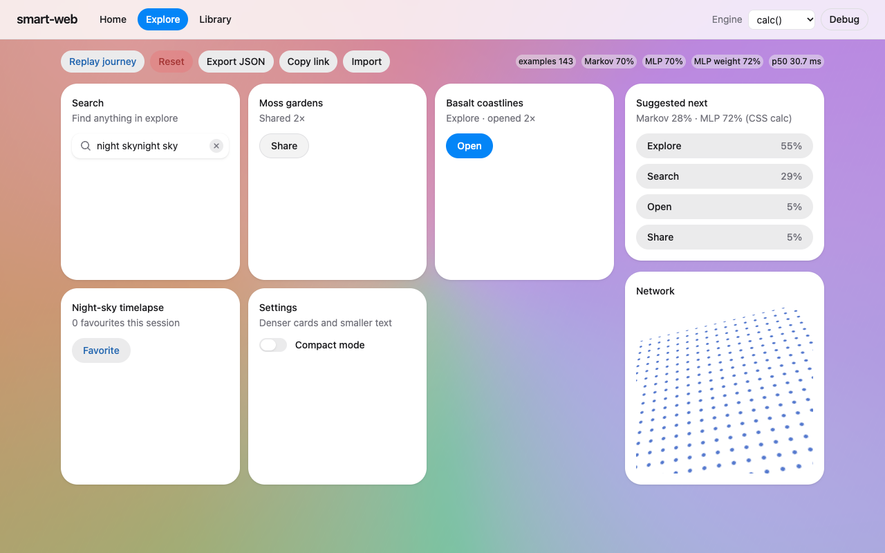
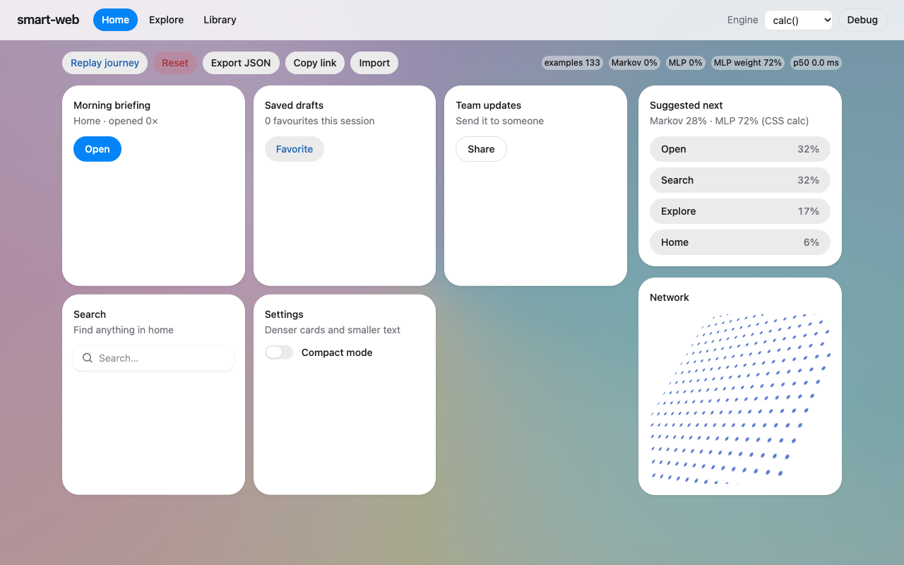
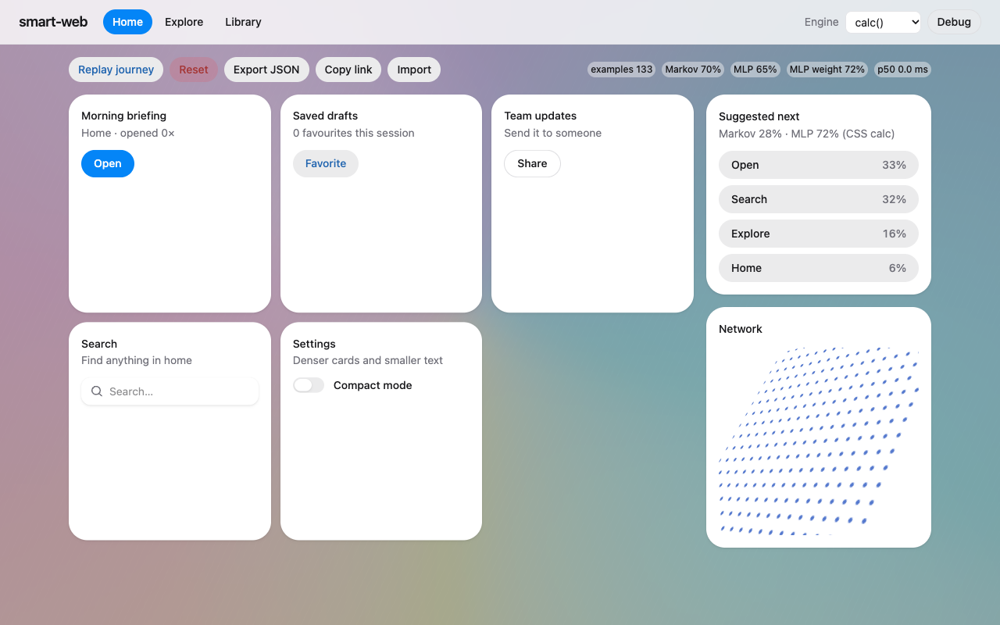
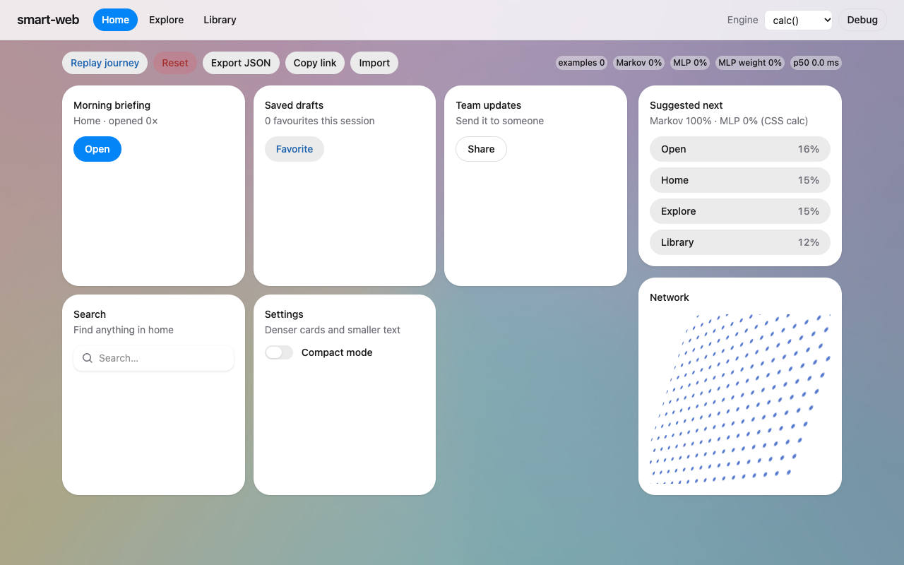
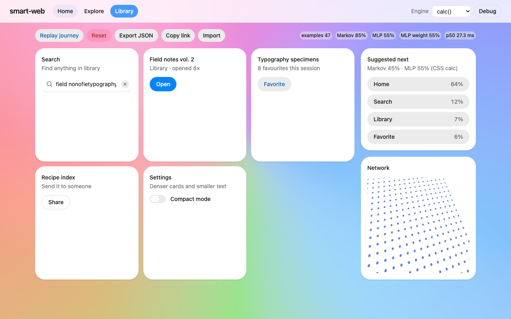
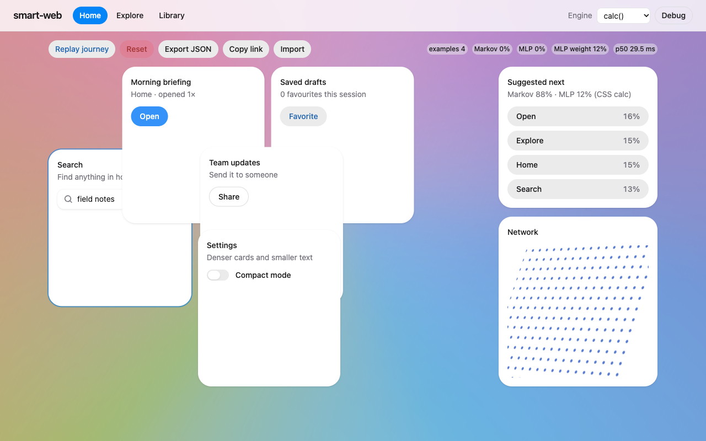
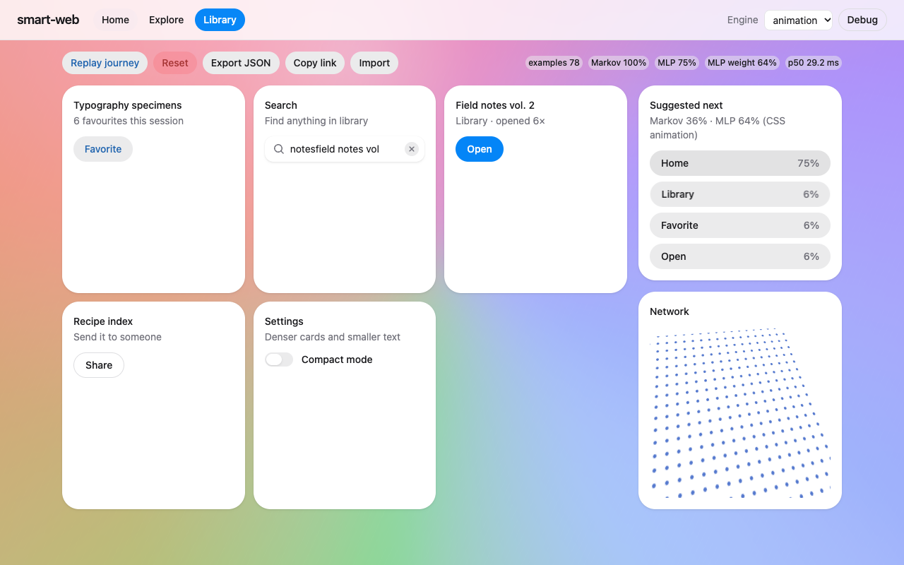
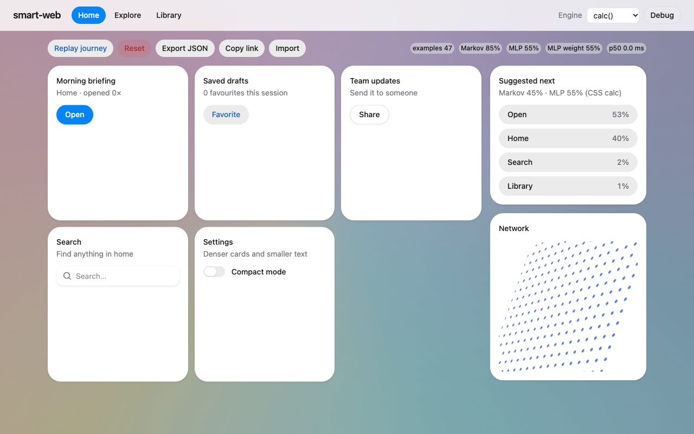
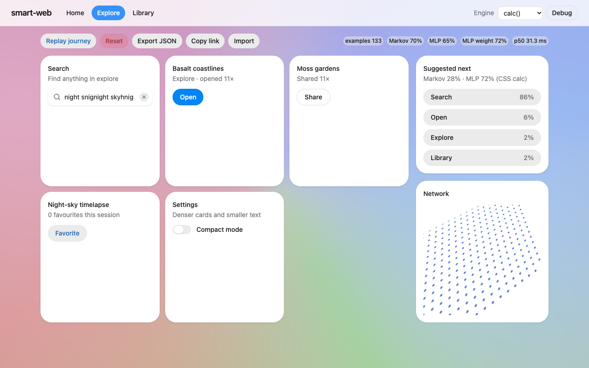
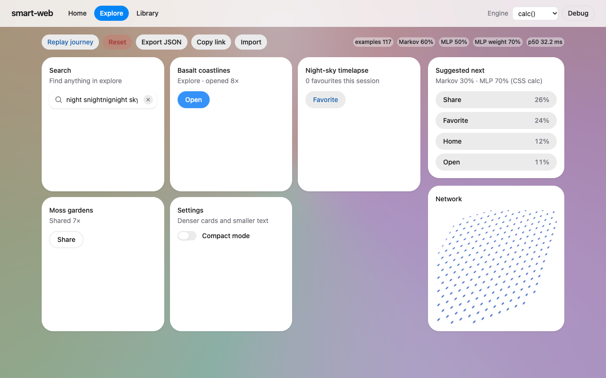
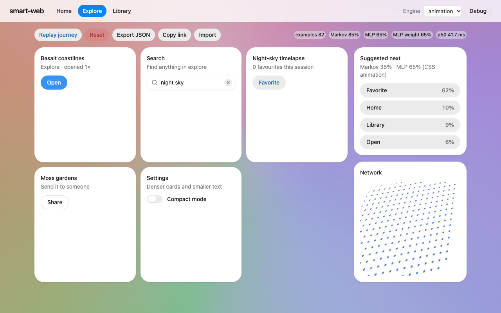
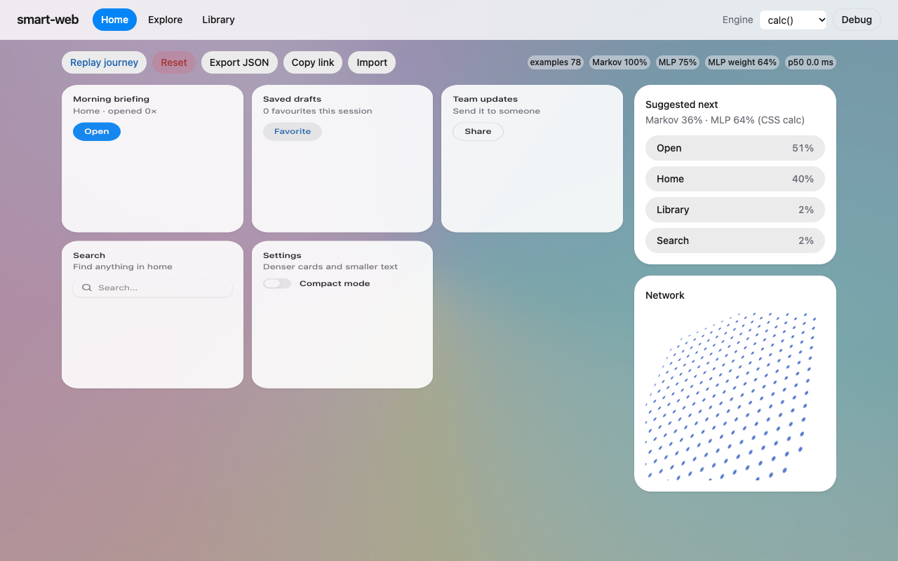
