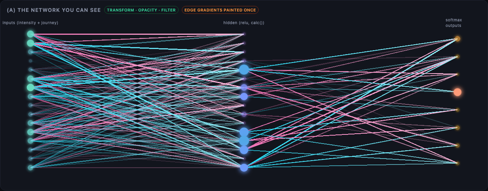
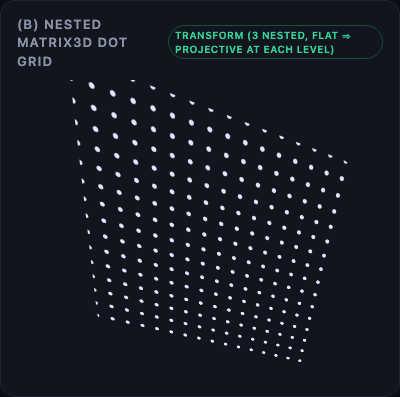
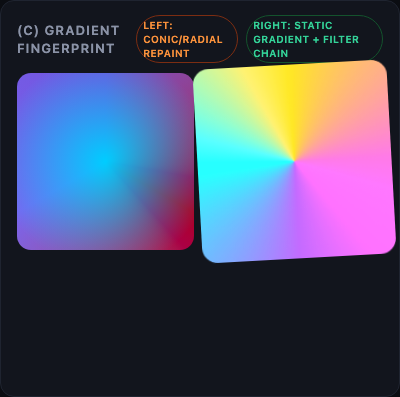
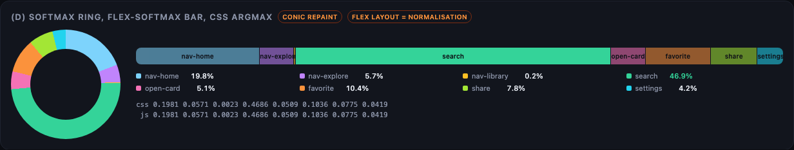

# R2 — Reading results back out of the CSS network, and making it visible

Research agent 2 of 2. Everything below was run headless in Chromium 156.0.8078.4 (Playwright 1.64, macOS) on 2026-10-22 unless a row says otherwise. Scripts live in `research/experiments/r2-*.mjs`, raw numbers in `research/experiments/out/`, screenshots in `research/screens/r2-*.png`. Run any script from the project root with `node research/experiments/<name>.mjs`.

Test net for all readback numbers: 16 inputs → 16 hidden (relu via `max(0, …)`) → 8 outputs (softmax via `exp()` / sum), all as registered `@property` custom properties and `calc()` on one host element `.net` (generator: `r2-net.mjs`). "Forward pass" = `setProperty` of the 16 inputs followed by the first read, which forces the style recalc that *is* the computation.

## 1. Readback channels

Timings are loop averages over 200–300 iterations (headless `performance.now()` is quantised to 100 µs, so single-shot numbers are useless). "light DOM" = just the net and the probes; "heavy DOM" = plus a 6000-element inline-block subtree *outside* `.net` whose container width depends on the net through `anchor-size()`, so a change to the net dirties layout of 6000 boxes but does not touch their style. A channel that gets ~7x slower on heavy DOM forces layout; one that stays at ~300 µs only forces style.

| Channel | Tested | Works | µs mutate+read (light / heavy) | Marginal µs per value | Forces | Precision (max abs err vs JS double) | Batchable |
|---|---|---|---|---|---|---|---|
| `getComputedStyle(el).getPropertyValue('--p')` on `@property <number>` | yes | yes | 325 / 347 (8 vals); 354 / 302 (16 vals) | ~0.3 | style only | 3.7e-6 (serialised to 6 significant digits, e.g. `"0.0863122"`) | yes: one `getComputedStyle` object, N `getPropertyValue` calls, no re-resolution between them |
| `el.computedStyleMap().get('--p')` (Typed OM) | yes | yes, returns `CSSUnitValue` with `.value` as full double | 326 / 297 | ~0.25 | style only | 3.4e-6 (no serialisation loss; residual is Chrome's float32 calc arithmetic) | yes |
| `getBoundingClientRect().width` of `width: calc(var(--p) * 10000px)` | yes | yes | 375 / 2024 | ~0.25 | style + layout | 3.5e-6 at ×10000 (LayoutUnit = 1/64 px → 1.6e-6 quantisation; scale up to ~3e7 px is allowed) | yes, each call cheap after first |
| `offsetWidth` of the same | yes | yes (integer px) | 366 / 2051 | ~0.15 | style + layout | 5e-5 at ×10000 (integer; use ×1e7 for 1e-7) | yes |
| `scrollWidth` sum pooling (inline-block children, `white-space: nowrap`, widths = values) | yes | yes | 370 / 2019 | one read gives Σ of 16 | style + layout | 6e-4 at ×1000 (integer px) | n/a (one number) |
| `scrollWidth` max pooling (abs-positioned children, `left` = value, container `overflow: hidden`) | yes | yes | 374 / 2017 | one read gives max of 16 | style + layout | 5e-4 at ×1000 | n/a |
| `document.elementFromPoint` ARGMAX (8 stacked boxes, `z-index: calc(var(--p) * 1e6)`) | yes | yes, 60/60 correct | 398 / 3158 | one call = argmax | style + layout + hit test | exact (integer index); ties broken by DOM order | n/a |
| CSS anchor positioning: `width: calc(anchor-size(--a0 width) + anchor-size(--a1 width) + …)` | yes | yes — cross-element sum, read via gBCR | 374 / 2012 | n/a | style + layout | 4e-6 | n/a |
| `Animation.effect.getComputedTiming().progress` (paused animation, `animation-delay: calc(var(--x) * -1s)`) | yes | reads the *input* back exactly; easing is **not** applied to `.progress` (`linear(0, 0 50%, 1)` gave progress = x, not 0) | 367 / 2099 | ~1 | style + layout (measured; `getAnimations()` is not cheap) | 5e-7 | poor (one animation object per value) |
| Scroll-driven timeline readout (`animation-timeline: scroll()`; `scrollLeft` fixed at 500 px, scrollable range = `calc(var(--x1) * 1000px)`; read `Animation.currentTime`) | yes | yes, gives 500 / (1000·x) as a percentage: 62.11 % read vs 62.13 % expected | not timed | — | layout | ~2e-4 (scrollbar/LayoutUnit) | no |
| `ResizeObserver` on `width: calc(var(--p) * 10000px)` | yes | yes | latency 700 / 3800 (async, next rendering step) | — | runs after layout in the frame | 1.7e-6 (`contentRect.width` is fractional) | callback delivers all observed entries at once |
| `IntersectionObserver` ratio (target 1000 px wide, `left: calc((var(--p) − 1) * 1000px)` inside a clipping root, 1001 thresholds) | yes | yes: ratio == p, fired 19/19 | latency ~7100 / 7500 (async, separate task after rendering) | — | after layout | 1.5e-5 | one callback per observed target; only fires on threshold crossings |
| Canvas: SVG `data:` URL with `<foreignObject>` + inline `@property`/`calc` net, colour = `rgb(calc(var(--p)*255) 0 0)`, `drawImage`, `getImageData` | yes | yes (the `<style>` text must be XML-escaped) | ~1300 per snapshot (8 values; includes `img.decode()`) | ~150 | separate image document; no effect on the page's layout | 1.9e-3 (8-bit) | one snapshot can hold thousands of values as pixels |
| view-timeline progress (`animation-timeline: view()`) | not tested | — | — | — | — | — | would need CSS to move an element through a scrollport; no obvious way to make its progress a function of a computed number beyond the `scroll()` trick above |

Notes

- The ~300 µs floor is the forward pass itself (style recalc of the calc chain), not the readback. Readback adds 2–7 µs for 8–16 values on any synchronous channel. So the readback choice is about **what the read forces**, not its own cost.
- Style-only readers (`getComputedStyle`, `computedStyleMap`) are the only ones that do not force layout. That matters because the app will have HeroUI's whole DOM in the page; every geometry-based channel re-lays out everything dirty.
- Chrome's `calc()` math is single precision: `exp(90)` in a `flex-grow` overflowed to equal `inf` widths (500 / 500 instead of 731 / 269), and the irreducible ~3e-6 error on `computedStyleMap` values is float32-sized. Treat 1e-5 as the practical precision of any CSS number.
- `getComputedStyle` output of a `<number>` property is serialised to 6 significant digits; `computedStyleMap().get(...).value` is the raw double. Both are equally fast, so prefer the Typed OM when precision matters.
- `display: none` on an element does **not** skip that element's own style computation; only its descendants are skipped (measured in `r2-demo-bisect2.mjs`: hiding 248 var-consuming elements saved nothing; removing them did).

## 2. Softmax and argmax done by layout

`r2-flex-softmax.mjs`: a flex row of 8 children with `flex: 1 1 0px; min-width: 0` and per child `flex-grow: calc(exp(var(--z_i)))`. Flex distributes the free space proportionally, which is exactly the softmax normalisation.

| Row width | Logit range | max abs err vs JS softmax | argmax correct | µs per evaluation (8 `setProperty` + layout + 8 gBCR) |
|---|---|---|---|---|
| 1000 px | ±2 and ±10 (200 cases) | 2.2e-5 | 200 / 200 | ~36 |
| 10000 px | same | 3.2e-6 | 200 / 200 | — |

Widths sum to exactly the container width (the sample sums to 1.000000). The error is LayoutUnit quantisation (1/64 px per child / row width), so a wider row is a more precise softmax.

Caveat found: with logits ≥ ~88.7 `exp()` overflows float32 and all overflowed children get equal width. Fix in CSS: `--zmax: max(var(--z0), …, var(--z7)); flex-grow: calc(exp(var(--z_i) - var(--zmax)))`. That is the standard numerically stable softmax and it is expressible in CSS; the demo page uses it.

Pure-CSS argmax flag (no JS comparison, `r2-visual-demo.html`, verified 100/100 against JS in `r2-visual-shots.mjs`):

```css
--pmax: max(var(--p0), …, var(--p7));
--is3: calc(1 - clamp(0, (var(--pmax) - var(--p3)) * 1e6, 1));   /* 1 for the argmax, 0 otherwise */
```

This gives any element a 0/1 number to drive opacity / outline / scale from. `elementFromPoint` over `z-index: calc(var(--p) * 1e6)` boxes is the alternative when the argmax must be read as an element, but it forces layout and a hit test (~400 µs light, ~3.2 ms heavy).

## 3. Visual layers (built, screenshots)

Demo: `research/experiments/r2-visual-demo.html` (standalone; open in Chrome or run `node research/experiments/r2-visual-shots.mjs`). Full page: `research/screens/r2-visual-demo.png`. Live stats in the header are from the page's own rAF loop. Compositor-layer facts below come from a CDP `LayerTree` probe (`r2-layers.mjs`): `will-change: transform|opacity|filter` and a running transform animation each produced their own layer with the matching compositing reason; a gradient background, a width change and a background-colour animation did not.

### (a) The network you can see — `r2-network.png`



Neurons are absolutely positioned circles with `--a` bound to the neuron's own CSS variable (`--a: var(--h3)` etc.). Size, brightness and hue come from `transform: scale(calc(…))`, `opacity: calc(…)` and `filter: hue-rotate(calc(…))`, all three of which are compositor properties (each neuron has `will-change: transform, opacity, filter` → own layer, verified). Edges are thin divs rotated once at build time; their fill is a static two-stop gradient coloured by weight sign (cyan positive, magenta negative), thickness = |w|, and only `opacity: clamp(0, var(--a-src) * var(--wabs) * 1.4, 1)` changes per frame (composited). Edges with |w| < 0.35 are omitted (208 drawn of 384).

Cost: this panel is the expensive one. Measured per forward pass with only this panel present (`r2-demo-bisect3.mjs`, elements removed rather than hidden): empty panel 262 µs; 40 neurons only 610 µs (8.7 µs/neuron); 208 edges only 1210 µs (4.6 µs/edge); 100 edges only 1096 µs — so the edge cost is not linear: there is a ~700 µs fixed cost as soon as edges are present plus ~1 µs per extra edge, which I did not isolate (suspect: compositor/paint-property updates for the 200 `will-change` layers being pulled into the forced style update). All panels together: 1.7–2.5 ms, versus 0.3 ms for the bare net. Isolated per-element costs (`r2-visual-cost2.mjs`, 250 elements each): class-only var consumer 0.5 µs; inline `--a-src: var(--h)` alias 0.75 µs; six static inline declarations (left/top/width/rotate…) 1.5 µs; `color-mix()` inside the gradient +1.5 µs (removed from the demo — it is re-resolved on every recalc); neuron with three clamp/calc properties plus `box-shadow` ~3.8 µs. Everything inside the `.net` subtree is re-styled on every input change even when it uses no variable (0.28 µs/element, `r2-visual-cost.mjs`); elements outside the subtree cost nothing.

### (b) Nested matrix3d dot grid — `r2-dotgrid.png`, `r2-dotgrid-2.png`



One element paints a dot lattice (`radial-gradient` + `background-size`, painted once). Three nested wrappers each carry a `matrix3d(calc(1 + var(--h0)*0.25), …)` / `rotate(calc(var(--h15)*25deg))` built from 16 hidden activations, inside a `perspective: 700px` stage, default `transform-style: flat` so each level applies its own perspective divide (the nonlinearity from the earlier findings). All per-frame change is `transform` with `will-change: transform` → compositor only; the only CPU work is the style recalc of 3 elements. This is the cheapest "alive" visual in the set.

### (c) Gradient fingerprint — `r2-fingerprint.png`



Left: `conic-gradient` + `radial-gradient` whose angle, centre, hue (`oklch(… calc(200 + var(--h3)*120))`) and stop position come from 8 hidden activations, with `transition: --h0 .4s, …` so the registered properties interpolate smoothly. This is a CPU repaint of the element every frame it changes (gradient rasterisation), fine at ~200 px, not for a full-screen background. Right: a static conic gradient painted once, animated only through `filter: hue-rotate() saturate() contrast() brightness()` and `transform: rotate() scale()` driven by 6 other activations — all compositor properties. The CSS `filter` chain is a per-pixel colour-matrix pipeline on the GPU, which is the practical replacement for an SVG `feColorMatrix` chain (SVG filter attributes cannot take `var()`, so an SVG chain would have to be rewritten from JS; not built).

### (d) Softmax ring, flex-softmax bar, CSS argmax — `r2-softmax.png`



Ring: `conic-gradient(k0 0 calc(var(--c0)*360deg), k1 0 calc(var(--c1)*360deg), …)` where `--c_i` are cumulative probabilities computed in CSS, so the slices *are* the softmax. CPU repaint, 170 px. Bar: the flex-softmax from section 2 with action labels; `opacity: calc(0.55 + var(--is-max) * 0.45)` highlights the CSS argmax. The legend shows the `getComputedStyle` readback next to the JS reference (agree to 4 decimals in the screenshot; max error 8.6e-6 over 100 random inputs in `r2-visual-stats.json`).

Frame budget with all four panels live and a `getComputedStyle` readback per frame: median rAF delta 16.7 ms (vsync-bound) at 1280×1000 headless; measured forward pass + readback in page ≈ 1.9–2.5 ms (of which ~1.5 ms is panel (a)).

## 4. Recommendations for `src/cssnet`

`readOutputs()` / `readHidden()`:

- Mount one small host element (`.net`) that owns the registered properties and the calc chain. Put **nothing else** inside it: every descendant is re-styled on each input change (0.28 µs/element minimum, several µs if it consumes variables).
- Read with the Typed OM: `const m = host.computedStyleMap(); for (o…) out[o] = m.get('--p' + o).value`. One `computedStyleMap()` call, N `.get()`s. Measured 297–326 µs including the forward pass, ~0.25 µs per extra value, no layout forced, full double precision (vs 6-digit serialisation from `getComputedStyle`). Fall back to `getComputedStyle(host).getPropertyValue` if `computedStyleMap` is absent; same cost.
- `readHidden()` is the same call on the same map (`--h0…--h15`): reading 16 more values costs ~4 µs. Do both reads from one map object per frame.
- Keep softmax inside CSS with the max-shifted form (`exp(var(--z) - var(--zmax))`), since Chrome's calc is float32 and logits can drift past 88 during training.
- Expose the CSS argmax flags (`--is0…--is7`) as well; the suggestion list can use them for the "top" highlight without a JS comparison, and `window.__smartweb.ranking()` can still sort in JS from `readOutputs()`.
- Do not use geometry channels (gBCR, offsetWidth, scrollWidth, elementFromPoint, anchor-size) for the per-frame read in the real app: they force layout of whatever HeroUI has dirtied (measured 2–3 ms with a 6000-box subtree). They are fine for tests and for the flex-softmax visual, where the layout is wanted anyway.
- For the Playwright hook `cssOutputs()` the same `computedStyleMap` read is the right thing; `cssOutputs()` vs `jsOutputs()` should agree to ≤ 1e-5 (observed ≤ 9e-6).

`PatternLayer` (`data-testid="pattern-layer"`):

- Use the fingerprint pattern (c): one element outside `.net`, coloured by a static multi-stop gradient and animated only via `filter` and `transform` with `will-change: filter, transform`. Feed it 4–6 hidden activations. Because it is outside the net subtree it cannot inherit the net's variables; write them from JS after `readHidden()` (6 `setProperty` calls ≈ 3 µs) onto its own `@property --f0…` with `inherits: false` and `transition: --f0 300ms …` for smoothing. This keeps the whole background on the compositor; the CPU gradient variant (left card) should stay small (≤ 300 px) if used at all.
- Optional CPU accent: the conic probability ring as a small badge near the suggestion list.

`DotGrid` (`data-testid="dot-grid"`):

- Pattern (b) exactly: one painted lattice, three nested `will-change: transform` wrappers with `matrix3d(calc(…))` entries from hidden activations, `perspective` on the stage, flat transform-style. Also outside `.net`, fed the same way as the PatternLayer (or inside `.net` if the lattice is the only thing there — 4 elements are negligible). Keep the perspective terms small (≤ 0.002/px) so the grid never folds through the camera.
- If a visible-network view (a) is wanted in the debug drawer, cap it at ~100 edges, give edges their static geometry by class (not inline style), avoid `color-mix()` and `box-shadow` on anything that reads a variable, and mount it only while the drawer is open; budget ~1 ms per frame for it.

## 5. Not done / untested

- `view()` timelines, `IntersectionObserver` as a routine channel (works but ~1 frame late and only on threshold crossings), SVG `feColorMatrix` chains (attributes cannot take `var()`).
- All numbers are from headless Chromium 156 on one Mac; headed Chrome with GPU raster may change the paint-side costs (not the style-recalc costs, which dominate here).
- The demo network panel's cost has a ~700 µs fixed component once edges with `will-change: opacity` exist (100 edges ≈ 834 µs, 208 edges ≈ 948 µs over the empty panel); the isolated per-element variants (0.5–1.9 µs) do not reproduce it, and the cause was not chased down. A quick thing to try before shipping a network view: drop `will-change` on the edges (compositing 200 tiny layers may be the fixed cost) and re-measure with `r2-demo-bisect3.mjs`.
- `r2-demo-bisect.mjs` / `r2-demo-bisect2.mjs` are kept for the record but their panel-hiding method under-reports (see the `display: none` note in section 1); `r2-demo-bisect3.mjs` is the one to trust.
